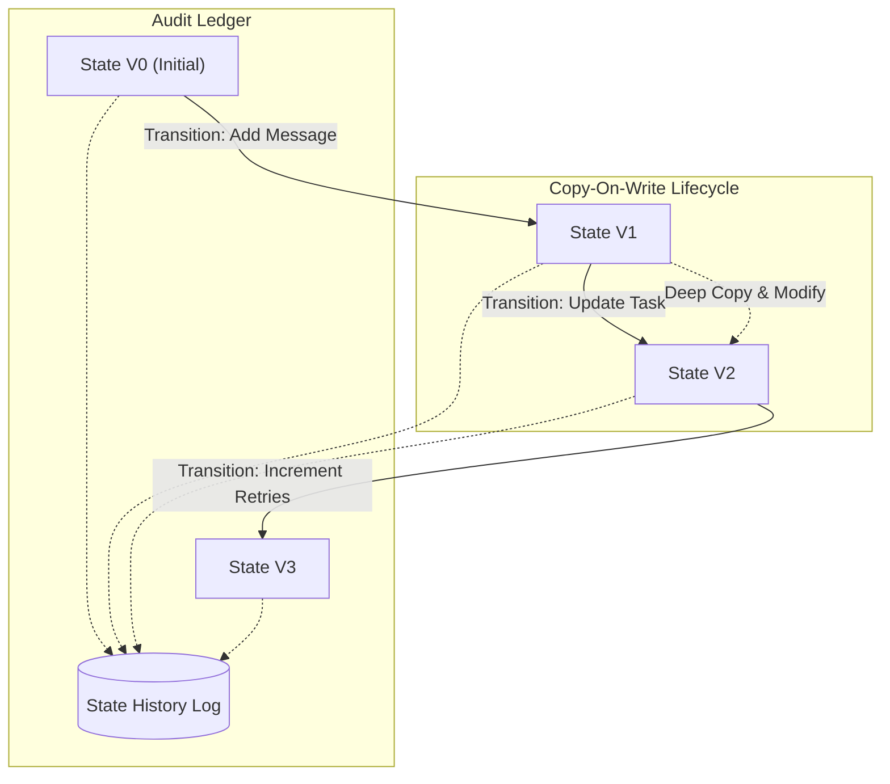

# Lesson 01: State - Architecture

This document describes the flow of state transitions, copy-on-write mechanisms, and audit logging.

## State Lifecycle and Transitions

In a production agent, the state behaves as an **append-only ledger** of transitions. Every mutation results in a new state instance, preserving the historic timeline.



---

## Component Layout

The state module is designed around three core interfaces:

1. **State Model (Schema)**: Defines the exact structure and validation rules for state variables (e.g., using `dataclasses` or `pydantic`).
2. **State Manager (Harness)**: Coordinates access, applies updates atomically, and handles threading/locking.
3. **Transition Rules (Reducers)**: Define exactly how a new state is computed given a state delta or event.

```
+-------------------------------------------------------------+
|                        State Manager                        |
|  - .get_current_state() -> State                            |
|  - .update(delta: dict) -> State   [Thread-Safe Lock]       |
|  - .rollback(version: int) -> State                         |
+-------------------------------------------------------------+
                               |
                               v
+-------------------------------------------------------------+
|                         State V[N]                          |
|  - messages: list[dict]                                     |
|  - metadata: dict                                           |
|  - execution_plan: list[str]                                |
|  - version: int                                             |
+-------------------------------------------------------------+
```

## Immutable Deep Copies vs. Reference Mutability

Consider the following contrast in Python memory allocation during state operations:

### The Problem (Reference sharing)
If state is cloned using a shallow copy:
```python
new_state = current_state.copy()
new_state["messages"].append(new_msg)
```
Because `messages` is a reference to a list, `current_state["messages"]` is also mutated. This breaks isolation.

### The Production Solution (Copy-On-Write)
We use recursive deep copying, or structural sharing, to guarantee complete isolation:
```python
import copy
new_state = copy.deepcopy(current_state)
new_state["messages"].append(new_msg)
```
This ensures the historic state remains perfectly intact, allowing safe concurrent reads and rollbacks.
