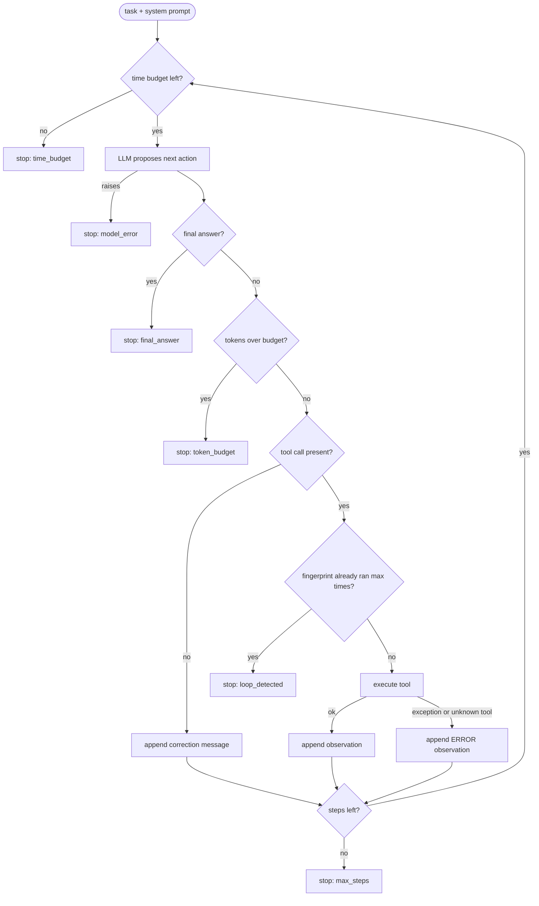

# Lesson 02: The Agent Loop - Architecture

This document shows the order of checks inside one step, how the components fit together, and how the naive loop and the bounded loop differ when something goes wrong.

## One Step of the Loop

Every check that can end a run sits outside the model. The model's only job is to propose the next action.



Every arrow into a box also writes an `Event`, so the log shows exactly which branch each step took.

---

## Component Layout

```
+---------------------------------------------------------------+
|                          AgentLoop                            |
|  run(task) -> RunResult                                       |
|    - Budget: max_steps, max_tokens, max_seconds,              |
|              max_identical_calls                              |
|    - call_counts: fingerprint -> times executed               |
|    - clock: Callable[[], float]   (injected; faked in tests)  |
+-------------------+--------------------------+----------------+
                    |                          |
                    v                          v
+-------------------------------+   +---------------------------+
|  LLMClient (Protocol)         |   |  Tools: dict[str, Tool]   |
|  complete(messages, tools)    |   |  search_docs(query)       |
|    -> ModelTurn               |   |  get_plan(account_id)     |
|  ScriptedLLM: replays turns,  |   |  errors -> "ERROR: ..."   |
|  records what it was shown    |   |  observations             |
+-------------------------------+   +---------------------------+
                    |
                    v
+---------------------------------------------------------------+
|  RunResult                                                    |
|    answer | stop_reason | steps | tokens_used                 |
|    events: tuple[Event]  -> to_json() per line (trace seed)   |
+---------------------------------------------------------------+
```

---

## Naive vs. Production: the Same Bad Run, Twice

The task is "Can acct-17 get a refund?". The model mistypes the account ID on its first call.

### Naive loop
```
step 1  model: get_plan(account_id="acct-71")
        KeyError: 'unknown account acct-71'      <- propagates out of run_agent()
        HTTP 500 to the user; nothing recorded except a stack trace
```
The model never sees the error, so it never gets the chance to fix the typo.

### Bounded loop (this lesson's demo output)
```
step 1 model_turn   Look up the plan.
step 1 tool_error   get_plan -> ERROR: KeyError: 'unknown account acct-71'
step 2 model_turn   Typo in the ID; retry.
step 2 tool_result  get_plan -> annual plan, purchased 2026-10-20
step 3 model_turn   Find the refund policy.
step 3 tool_result  search_docs -> [billing-04] Annual plans can be refunded in full within 30 days ...
step 4 model_turn   Purchased 12 days ago; inside the window.
step 4 stopped      final_answer
```
The error became an observation, the model corrected itself, and the log shows every branch taken. When the model gets stuck instead, the log ends with `stopped loop_detected` at the step where it proposes the same search a third time; the tool itself ran only twice.

### Why the stop reason matters downstream
| Stop reason | What the caller should do |
|---|---|
| `final_answer` | return it (and, in later lessons, validate it first) |
| `max_steps`, `token_budget`, `time_budget` | show "couldn't finish"; count per prompt version; raise the budget or fix the prompt |
| `loop_detected` | usually a tool that returns nothing useful, or a prompt that doesn't say when to give up |
| `model_error` | a provider failure: retry the run, or fall back (Lessons 14 and 16) |
