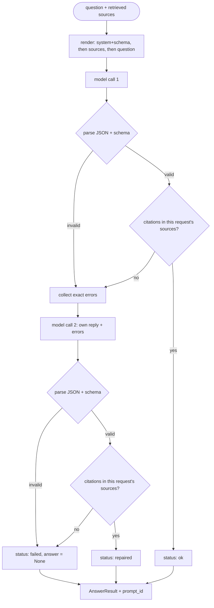

# Lesson 03: Prompting & Structured Output - Architecture

This document shows the validate → repair → fail-closed flow, how a rendered prompt is laid out for caching, and what happens to the same bad reply in a naive and a production pipeline.

## Validate, Repair Once, Fail Closed



There are at most two model calls per question. Every path ends in an `AnswerResult` that carries the errors seen and the exact `prompt_id`, so the repair rate and the failure rate can be measured per prompt version.

---

## Prompt Layout for Prefix Caching

Prompt caches reuse work only for an identical prefix. The render order puts content from most stable to least stable:

```
+-------------------------------------------------------------+  identical for every request
| system: instructions + JSON Schema of GroundedAnswer        |  on grounded_answer@v2
+-------------------------------------------------------------+
| user:  Sources:                                             |  identical for follow-up
|        [pto-01] Full-time employees accrue 1.5 days ...     |  questions on the same
|        [pto-03] Up to 10 unused leave days carry over ...   |  retrieved documents
|                                                             |
|        Question: How many unused leave days carry over?     |  changes every request
+-------------------------------------------------------------+
| (repair only) assistant: <the rejected reply>               |  appended after the cached
| (repair only) user: "Your reply was rejected: - ..."        |  prefix, so a repair is cheap
+-------------------------------------------------------------+
```

Putting `Today is 2026-11-01` or a user's name at the top of the system prompt would make the first line differ between requests, and nothing after it could be reused.

---

## Component Layout

```
+-------------------------+      +--------------------------------------+
| PromptRegistry          |      | PromptTemplate (frozen)              |
|  register(t): refuses   |----->|  name, version, system               |
|  same name@version with |      |  fingerprint = sha256(system)[:12]   |
|  different text         |      |  prompt_id = name@version#hash       |
+-------------------------+      +------------------+-------------------+
                                                    |
                                                    v
+------------------+   render()   +-------------------------------------+
| Source(id, text) |------------->| answer_question(llm, t, sources, q) |
+------------------+              |   LLMClient.complete(messages)      |
                                  |   parse_output(raw, allowed_ids)    |
                                  |     1. strip fence                  |
                                  |     2. GroundedAnswer (Pydantic)    |
                                  |     3. citations within allowed_ids |
                                  +------------------+------------------+
                                                     |
                                                     v
                                  +-------------------------------------+
                                  | AnswerResult                        |
                                  |  status: ok | repaired | failed     |
                                  |  answer | errors | prompt_id | calls|
                                  +-------------------------------------+
```

---

## Naive vs. Production: One Bad Reply

The model replies with valid JSON inside a markdown fence, citing `pto-09`, a source that doesn't exist.

| Step | Naive (`json.loads`, fall back to raw text) | Production (this lesson) |
|---|---|---|
| Parse | `json.loads` fails on the fence → fallback returns the raw fenced text as the answer | fence stripped, JSON parsed |
| Shape | not checked | `GroundedAnswer` validates fields and the found/citation rule |
| Grounding | not checked | `pto-09` is not among the request's source IDs → rejected |
| Recovery | none, or "ONLY JSON PLEASE" | repair message names the bad ID and the allowed IDs |
| Result | UI renders a broken citation link, or raw JSON as the answer | `repaired` answer citing `pto-03`, or `failed` with no answer |
| Afterwards | no record of which prompt produced it | `prompt_id` + error list on every result, ready for monitoring |
