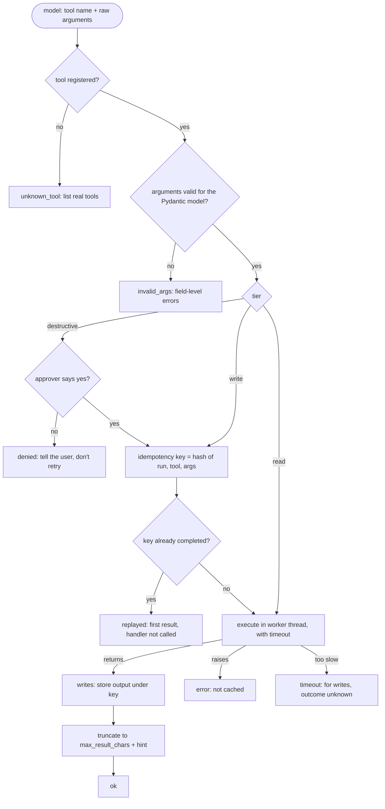
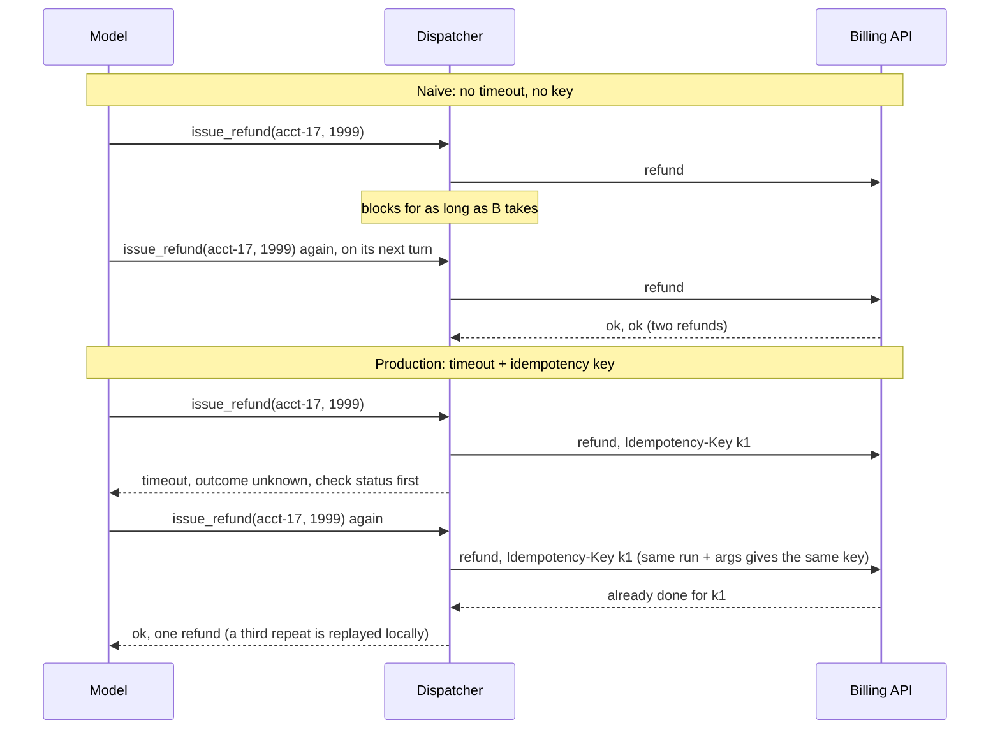

# Lesson 04: Tool Calling - Architecture

This document shows the fixed pipeline every tool call goes through, how the components fit together, and how a slow, repeated refund plays out in a naive and a production dispatcher.

## The Call Pipeline



Every terminal box is a `ToolResult(outcome, content)`. The content is the observation the agent loop from Lesson 02 appends for the model, so every failure is something the model can read and act on.

---

## Component Layout

```
+--------------------------------------------------------------------+
| ToolRegistry                                                       |
|   register(ToolSpec)          duplicate names refused              |
|   schemas() -> [{name, description, parameters: JSON Schema}]      |
|   call(name, raw_args, run_id) -> ToolResult                       |
|   approver: (tool, validated_args) -> bool    default: deny_all    |
|   _completed: idempotency key -> output   (Redis/Postgres later)   |
|   _pool: ThreadPoolExecutor               (timeouts)               |
+-----------------------------+--------------------------------------+
                              |
              +---------------+----------------+
              v                                v
+-----------------------------+   +--------------------------------+
| ToolSpec (frozen)           |   | ToolContext                    |
|   name, description         |   |   run_id                       |
|   args: type[BaseModel]     |   |   idempotency_key  -> forward  |
|   handler(args, ctx) -> str |   |   it to the downstream API     |
|   tier: READ|WRITE|DESTR.   |   +--------------------------------+
|   timeout_s                 |
+-----------------------------+
```

A tool from an MCP server plugs in as one more `ToolSpec`: its `inputSchema` becomes the argument model (or is validated directly), and the handler forwards the call to the server. The tier and timeout are still set by your harness.

---

## Naive vs. Production: the Slow, Repeated Refund

The billing API is slow today. The model calls `issue_refund`, doesn't see a result in time, and calls it again with the same arguments.



Two layers of deduplication are at work. The registry's `_completed` map catches repeats after a write has finished. The key forwarded to the billing API catches the cases the registry can't see: a timed-out first attempt that still finished, or a crash between the API acting and the result being stored.
