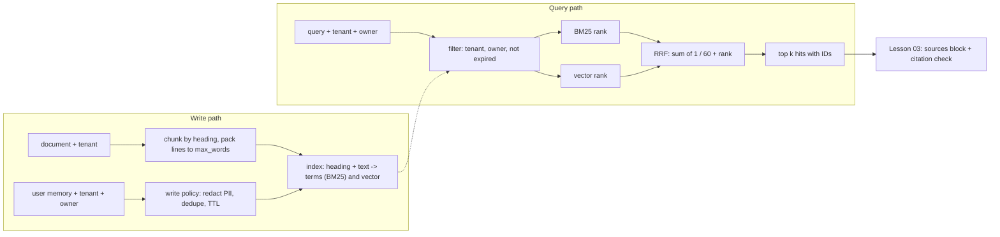
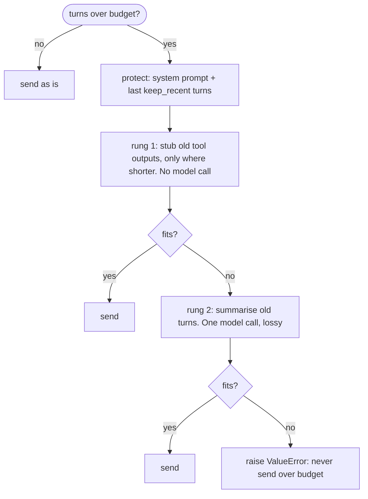

# Lesson 05: Memory & Retrieval - Architecture

This document shows the two paths through long-term memory (writing and searching), how the components fit together, the compaction ladder for short-term memory, and why filtering after ranking fails.

## Write Path and Query Path



Deletion has its own two entry points: `purge_expired()` for records past their TTL, and `forget(tenant, owner)` for a user's deletion request. Search already ignores expired records; purging removes them from storage.

---

## Component Layout

```
+--------------------------------------------------------------------+
| MemoryStore                                                        |
|   add_document(tenant, doc_id, text) -> chunk ids                  |
|   remember(tenant, owner, text, ttl_s) -> memory id (write policy) |
|   search(query, tenant, owner, k) -> [Hit]                         |
|   forget(tenant, owner) / purge_expired()                          |
|   _records: (tenant, id) -> Record                                 |
+------------------------------+-------------------------------------+
                               |
          +--------------------+---------------------+
          v                                          v
+------------------------------+    +----------------------------------+
| Record (frozen)              |    | Embedder (Protocol)              |
|   id, tenant, owner, kind    |    |   embed(text) -> unit vector     |
|   text, section, expires_at  |    |   ConceptEmbedder: offline toy   |
|   terms (BM25), vector       |    |   real model: same interface,    |
+------------------------------+    |   one model per index version    |
                                    +----------------------------------+
+--------------------------------------------------------------------+
| Hit: record, rrf score, lexical_rank | None, vector_rank | None    |
|   (both ranks are kept so you can see which retriever found it)    |
+--------------------------------------------------------------------+

Short-term:  compact(turns, budget, summarize, keep_recent) -> turns
```

---

## The Compaction Ladder

Each rung costs more, or loses more, than the one before it. Climb only as far as the budget requires.



---

## Naive vs. Production: Filter After vs. Before Ranking

Tenant `acme` has one invoice chunk. Tenant `globex` has 20 chunks that match "invoice emailed" more strongly. The request is `search("invoice emailed", tenant="acme", k=1)`.

| | Rank, then filter (naive patch) | Filter, then rank (this lesson) |
|---|---|---|
| Ranked set | 21 chunks from both tenants | 1 chunk, acme only |
| Top 1 | a globex chunk | the acme invoice chunk |
| After the tenant filter | **empty**: the agent says "I don't know" | 1 hit, correct tenant |
| If someone forgets the filter | globex's text goes into acme's prompt | impossible: the filter is inside `search` |
| BM25 statistics | computed over other tenants' documents too | computed over what this caller may see |

If you move the filter after ranking (see Try It in the README), `test_filtering_before_ranking_still_fills_k` fails with exactly the left column's outcome: an empty result.
