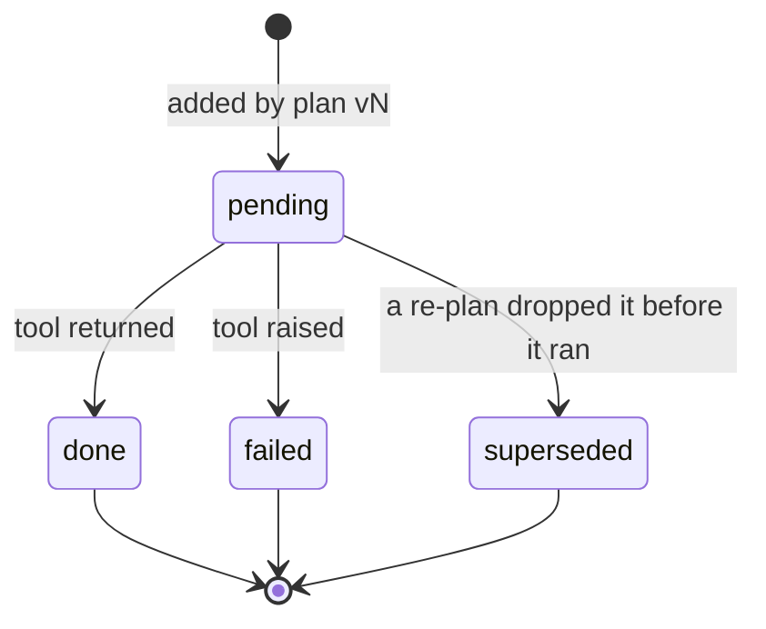
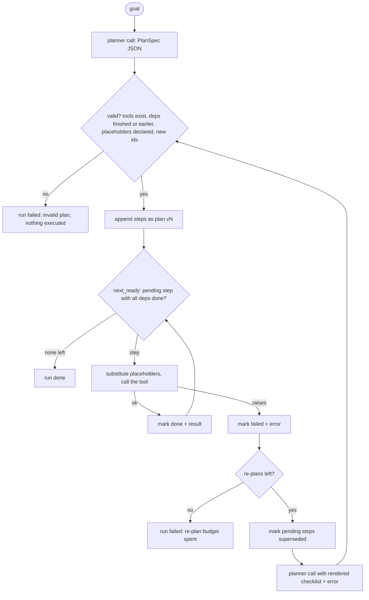

# Lesson 06: Planning & Task Decomposition - Architecture

This document shows the lifecycle of a single step, the execute and re-plan flow, the components, and what happens to the same mid-plan failure in a naive and a production executor.

## Step Lifecycle



`done` and `failed` are final. A re-plan never changes them; it only appends new steps with new IDs. That rule is what makes "the refund happened exactly once" true.

---

## Execute and Re-plan



---

## Component Layout

```
+--------------------------------------------------------------------+
| PlanExecutor(llm, tools, max_replans)                              |
|   run(goal) -> RunReport(status, plan, replans, reason)            |
|   _plan(plan, failure) -> planner call -> PlanSpec -> validate     |
+-------------------------------+------------------------------------+
                                |
         +----------------------+----------------------+
         v                                             v
+------------------------------+     +-------------------------------+
| PlanSpec / StepSpec          |     | Plan (owned by the harness)   |
|  (what the model writes)     |     |   goal, version               |
|  id, description, tool,      |     |   steps: [Step(spec, version, |
|  args ("{s1}" placeholders), |     |           status, result)]    |
|  depends_on; max 8 steps     |     |   next_ready() / mark()       |
+------------------------------+     |   results() / progress()      |
                                     |   render() -> checklist text  |
validate_plan(spec, tools, plan)     +-------------------------------+
  -> PlanError listing every problem
```

---

## Naive vs. Production: a Failure at Step 3

Goal: refund the duplicate charge and tell the customer. Step 3 (email) fails because there is no email address on file.

| | Naive (prose plan, start over on error) | Production (this lesson) |
|---|---|---|
| Steps 1-2 | find charge, refund: **done** | find charge, refund: **done** |
| Step 3 fails | output contains "error", so the run starts over | `s3` marked `[!]` with `LookupError: ... no email address on file` |
| Recovery | a new prose plan from scratch | planner sees the checklist; pending steps superseded |
| Refund | **issued again** by the new plan | not touched: `s1`, `s2` stay done |
| New work | whatever the new plan says | `s4 create_callback`, using `{s2}` (the refund result) |
| Bounded? | no: can recurse forever | `max_replans`; plan size ≤ 8 |
| Record | none | every step's version, status and result in the `RunReport` |
