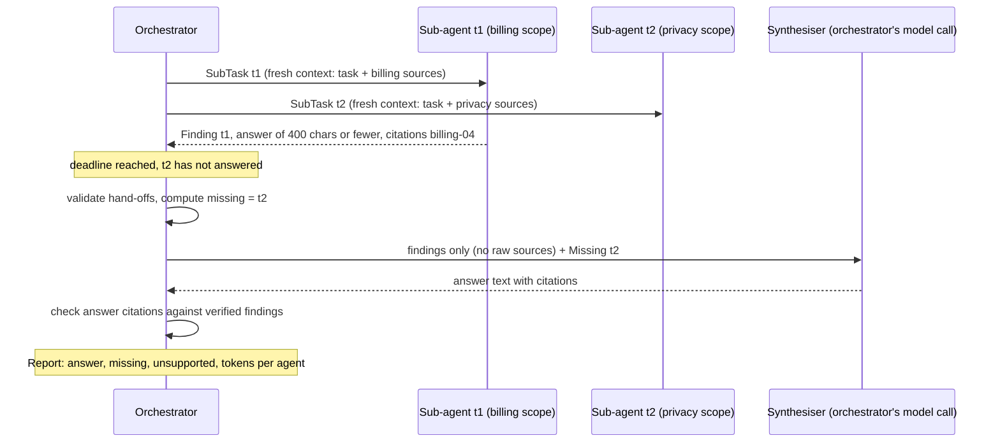

# Lesson 07: Multi-Agent Coordination - Architecture

This document shows the fan-out/fan-in flow, what each agent can see, the components, and how a timed-out sub-agent is handled by a naive and a production orchestrator.

## Fan-out, Fan-in



---

## Who Sees What

| Context | Sub-agent t1 | Sub-agent t2 | Synthesiser |
|---|---|---|---|
| The user's goal | no | no | yes |
| Its own sub-task | yes | yes | all sub-task questions |
| Billing documents | yes | no | no (only cited IDs) |
| Privacy documents | no | yes | no (only cited IDs) |
| Other agents' work | no | no | findings only (400 chars max each) |
| Which parts are missing | n/a | n/a | yes, computed by the harness |

---

## Component Layout

```
+---------------------------------------------------------------------+
| Orchestrator(llm, corpora, max_parallel, deadline_s)                |
|   run(goal, tasks) -> Report                                        |
|     fan-out: ThreadPoolExecutor(max_parallel) + wait(deadline)      |
|     fan-in:  SubResult per task, missing, synthesis, citation check |
|   _sub_agent(task) -> SubResult    (runs in a worker thread)        |
+--------------------------+------------------------------------------+
                           |
        +------------------+------------------+
        v                                     v
+------------------------------+   +----------------------------------+
| SubTask (Pydantic)           |   | Finding (Pydantic, extra=forbid) |
|   id, question, scope        |   |   task_id, answer <= 400 chars,  |
+------------------------------+   |   citations (>= 1)               |
                                   +----------------------------------+
+---------------------------------------------------------------------+
| SubResult: task, finding | None, error, tokens                      |
| Report: answer | None, results, missing, unsupported,               |
|         tokens_by_agent, complete (property)                        |
+---------------------------------------------------------------------+
```

---

## Naive vs. Production: a Sub-agent Misses the Deadline

| | Naive (serial, shared context, free text) | Production (this lesson) |
|---|---|---|
| Latency | sum of all sub-agents; a hung call hangs the request | one deadline for the batch; stragglers are abandoned |
| t2's failure | exception ends the run, or `except: pass` drops it | `SubResult(t2, None, "no result within 0.3s")` |
| What the synthesiser is told | "combine these answers" | findings + an explicit `Missing: t2` list |
| Synthesis claims the missing part | goes to the user unchallenged | `[privacy-02]` is not cited by any verified finding → `unsupported` |
| Report | an answer string | `complete=False`, `missing=('t2',)`, `unsupported=('privacy-02',)`, tokens per agent |
| Cost visibility | none | `tokens_by_agent`; note that t2 may still be spending in the background |
