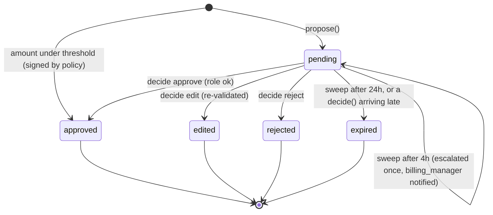
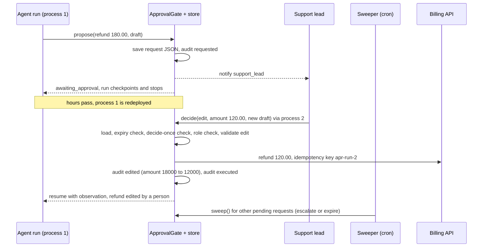

# Lesson 08: Human Approval - Architecture

This document shows the life of an approval request, how the pieces interact over time, the components, and what a naive and a production gate do with the same refund.

## Request Lifecycle



Only `approved` and `edited` execute anything, and each terminal state is reached once. Every later `decide()` is refused with "already …".

---

## Over Time, Across Processes



---

## Component Layout

```
+--------------------------------------------------------------------+
| ApprovalGate(store, execute, notify, clock, thresholds)            |
|   propose(run_id, args, draft) -> Outcome                          |
|   decide(request_id, Decision) -> Outcome                          |
|   sweep() -> ["... escalated", "... expired"]                      |
+-----------------------------+--------------------------------------+
                              | JSON in / out
                              v
+--------------------------------------------------------------------+
| ApprovalRequest (Pydantic; the unit of persistence)                |
|   id, run_id, args: RefundArgs, draft, required_role               |
|   status, created_at, escalate_at, expires_at, escalated           |
|   final_draft, signed_by                                           |
|   audit: [AuditEntry(at, actor, event, detail)]   append-only      |
+--------------------------------------------------------------------+
| Decision: actor, role, verdict (approve | edit | reject),          |
|           amount_cents?, draft?, reason                            |
| Outcome:  status, request_id, observation (for the resumed agent)  |
+--------------------------------------------------------------------+
```

---

## Naive vs. Production: the 180.00 Refund

| | Naive (`input()` in the request handler) | Production (this lesson) |
|---|---|---|
| While waiting | a blocked process; lost at the next deploy | a stored request; no process waits |
| Approver sees | a sentence the code printed | validated arguments + the draft, with role required |
| Wrong amount | approve and fix later, or reject and start over | edit to 120.00, re-validated, then executed |
| Double click | two refunds | second decision refused; idempotency key downstream |
| Nobody answers | waits forever (or a timeout says yes) | escalates at 4h, expires at 24h, never executes |
| Afterwards | nothing to show an auditor | who, when, what changed, what ran, plus similarity to the draft |
