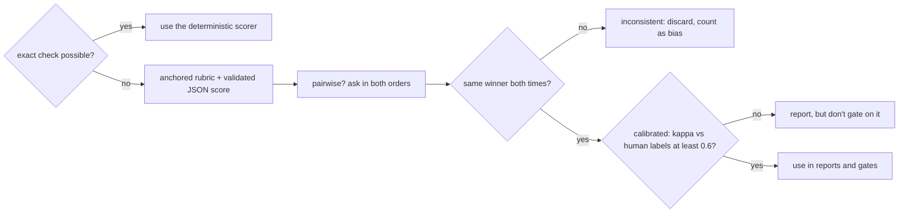

# Lesson 09: Evaluation & Self-Reflection - Architecture

This document shows how one golden case is scored and diagnosed, when an LLM judge is allowed to count, the components, and how a naive and a production evaluation read the same three results.

## Scoring and Diagnosing One Case

```mermaid
flowchart TD
    Case([golden case + system output]) --> R[Recall@k and reciprocal rank vs relevant ids]
    Case --> F[required facts in the answer]
    Case --> G[grounded: cites something, only retrieved ids]
    Case --> M[missing items = expected minus returned, in code]
    R --> D{diagnosis}
    F --> D
    G --> D
    M --> D
    D -- recall is 0 --> RM[retrieval_miss: fix chunking, retrieval, filters]
    D -- not grounded --> UG[ungrounded: fix prompt or citation check]
    D -- items missing --> IN[incomplete: split the task, check completeness in code]
    D -- facts missing --> GM[generation_miss: fix prompt or model]
    D -- all checks pass --> P[pass]
```

Retrieval is checked first because a model can't use evidence it was never shown. A generation fix can't repair a retrieval miss.

---

## When a Judge's Score Counts



The self-review sits outside both diagrams on purpose. It can trigger a retry, but it never feeds the diagnosis or a gate.

---

## Component Layout

```
+---------------------------------------------------------------+
| GoldenCase: id, question, relevant_ids, required_facts,       |
|             expected_items                                    |
| SystemOutput: retrieved (ranked), answer, citations, items    |
+------------------------------+--------------------------------+
                               | score_case(case, output, k)
                               v
+---------------------------------------------------------------+
| ScoreCard: recall, reciprocal_rank, facts, grounded,          |
|            missing_items  ->  passed, diagnosis               |
+---------------------------------------------------------------+
Scorers:  recall_at_k, precision_at_k, reciprocal_rank, facts_found
Judge:    judge_pointwise (RUBRIC, JudgeVerdict 1-5), judge_pairwise
Trust:    cohens_kappa, calibrate -> Calibration(agreement, kappa, trusted)
Signal:   self_review (reported, never decisive)
```

---

## Naive vs. Production: the Same Three Results

| Case | What happened | Naive judge "1-10" | This lesson |
|---|---|---|---|
| g1 | correct, cited | 9 | pass |
| g2 | right chunk never retrieved; confident wrong answer citing a retrieved chunk | 8 (it reads well) | `retrieval_miss`: fix retrieval, not the prompt |
| g3 | 4 of 5 invoices; self-review says complete | 9 (it looks complete) | `incomplete ['inv-1044']`, found in code |
| Overall | | "8.7, ship it" | 1 of 3 passing, with two named components to fix |
