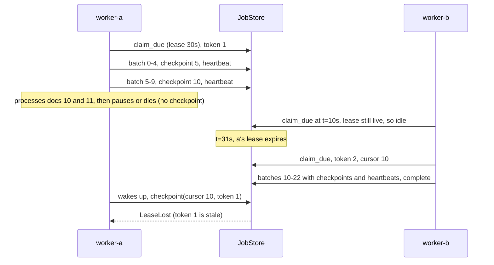
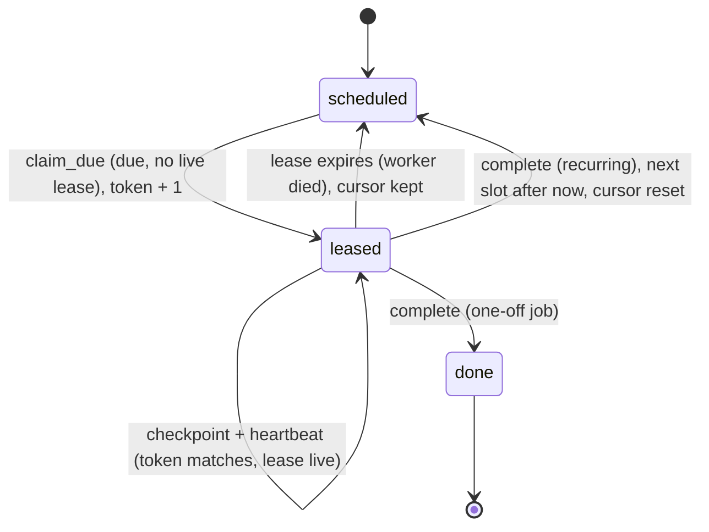

# Lesson 10: Scheduling & Long-Running Tasks - Architecture

This document shows a crash-and-resume timeline with a zombie worker, the states a job moves through, the components, and the naive and production behaviour side by side.

## Crash, Takeover, Zombie



Docs 10 and 11 were processed by both workers. That is the price of at-least-once resume, and it's safe only because each step is an upsert.

---

## Job States



`leased` isn't a stored status; it is "scheduled with a live lease". That is why a dead worker needs no clean-up: the lease simply runs out.

---

## Component Layout

```
+---------------------------------------------------------------------+
| JobStore(clock)          one atomic operation per method            |
|   schedule(job_id, total_items, run_at, every_s?)                   |
|   claim_due(worker, lease_s) -> Lease(job_id, owner, token) | None  |
|   heartbeat(lease, lease_s) / checkpoint(lease, cursor)             |
|   complete(lease)        -> done, or next slot (coalesced)          |
|   _check(lease)          -> LeaseLost if token stale or lease over  |
+-----------------------------------+---------------------------------+
                                    |
                                    v
+---------------------------------------------------------------------+
| Job: id, total_items, next_run_at, every_s, status, cursor,         |
|      lease_owner, lease_expires_at, fencing_token, runs_completed   |
+---------------------------------------------------------------------+
run_worker(store, worker, process_item, batch_size, lease_s)
  -> WorkerReport(outcome: idle | completed | crashed | lease_lost,
                  started_at_cursor, processed)
```

---

## Naive vs. Production

| Situation | Naive (`running` flag, all-or-nothing loop) | Production (this lesson) |
|---|---|---|
| Two workers see the job due | both start it | one claim succeeds, the other is `idle` |
| Worker crashes at doc 12 of 23 | `running=True` forever; the job is stuck | lease expires; next worker resumes at 10 |
| Work repeated after the crash | everything (if anyone notices) | at most one batch, made safe by idempotent upserts |
| Paused worker wakes up | keeps writing over the new owner | `LeaseLost`: stale token rejected |
| Nightly job started 10 min late | next run drifts 10 min later | next run on the usual slot |
| Scheduler down three nights | depends on the loop: zero runs or a burst | one coalesced run, then back on schedule |
