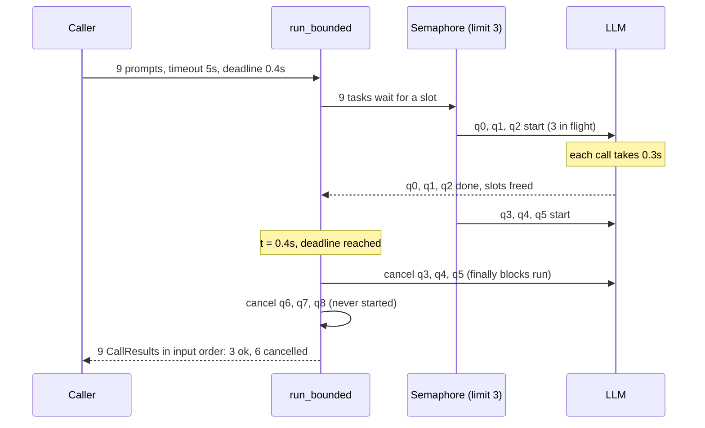
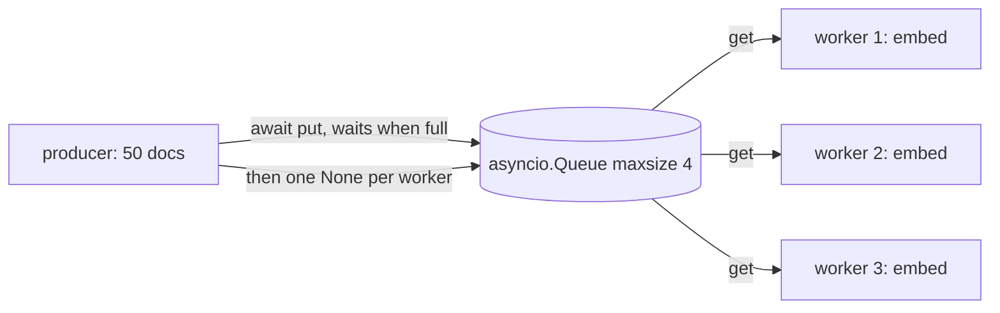

# Lesson 11: Async Execution - Architecture

This document shows how a bounded batch moves through the semaphore, what happens at the deadline, how the backpressure pipeline is wired, and how a naive and a production batch behave under the same conditions.

## A Bounded Batch with a Deadline



If the caller is cancelled instead, the same `finally` block runs, so no call outlives `run_bounded` either way.

---

## Backpressure Pipeline



The queue's size is the memory bound. The number of workers is the concurrency bound. The producer's speed no longer matters.

---

## Component Layout

```
+--------------------------------------------------------------------+
| run_bounded(prompts, call, limit, timeout_s, deadline_s?)          |
|   Semaphore(limit) -> wait_for(call, timeout_s) per prompt         |
|   wait(tasks, deadline) + finally: cancel + gather (no orphans)    |
|   -> [CallResult(index, ok, value, error, seconds)] in input order |
+--------------------------------------------------------------------+
| pipeline(docs, embed, workers, queue_size) -> PipelineStats        |
|   producer --(bounded Queue)--> N consumers; stop signal per worker|
+--------------------------------------------------------------------+
| max_loop_lag(work) -> worst ticker delay while `work` ran          |
|   blocking_inside_async()  vs  offloaded_to_thread() (to_thread)   |
+--------------------------------------------------------------------+
| AsyncLLMClient (Protocol): async complete(prompt) -> str           |
| FakeAsyncLLM: per-prompt latency/failure, in_flight, peak, cleanups|
+--------------------------------------------------------------------+
```

---

## Naive vs. Production: Nine Calls, One Hung

| | `asyncio.gather(*calls)` | `run_bounded(limit=3, timeout_s=0.2, deadline_s=...)` |
|---|---|---|
| Calls in flight | 9 (or 5,000) at once | at most 3 |
| One call hangs | the whole gather waits forever | that call times out alone; its slot is freed |
| One call raises | gather raises; other calls keep running unobserved | one `CallResult(ok=False, error="ConnectionError: ...")` |
| Deadline passes | not expressible | unfinished calls cancelled and cleaned up; marked `cancelled` |
| Caller cancelled | children may keep running and spending | children cancelled in `finally`; `in_flight == 0` afterwards |
| Blocking call inside | every task in the process stalls | moved to `asyncio.to_thread`; loop lag ≈ 0.01 s |
