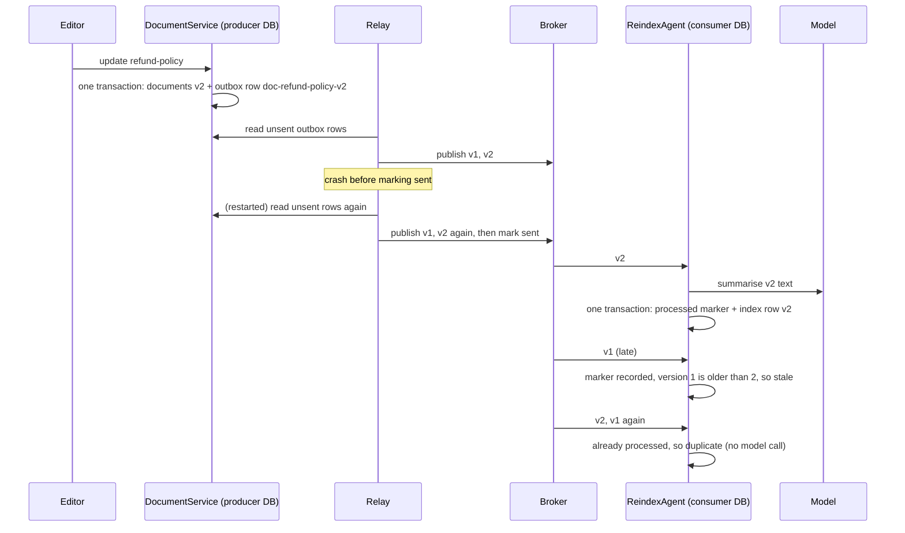
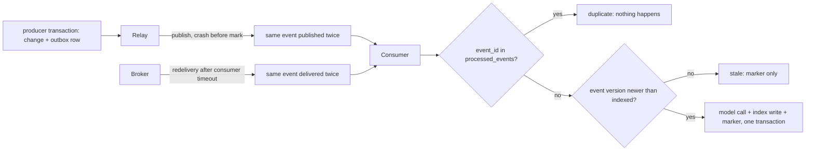

# Lesson 12: Event-Driven Agents - Architecture

This document shows the path of one change from the producer's transaction to the consumer's, where duplicates come from and where they stop, the components, and the naive and production behaviour side by side.

## From Change to Index



---

## Where Duplicates Come From and Where They Stop



Duplicates are created upstream on purpose (at-least-once) and absorbed in exactly one place: the consumer's transaction.

---

## Component Layout

```
Producer database                     Consumer database
+----------------------------+        +-----------------------------------+
| documents(id, text,        |        | search_index(doc_id, text,        |
|           version)         |        |              summary, version)    |
| outbox(seq, event_id UNIQUE|        | processed_events(event_id PK)     |
|        payload, sent)      |        +-----------------------------------+
+-------------+--------------+                       ^
              | relay_once(service, broker)          | ReindexAgent.handle(event)
              v                                      |   -> applied | duplicate | stale
        +-----------+      Event(event_id, type,     |
        |  Broker   |------ doc_id, version, text) --+
        +-----------+
```

---

## Naive vs. Production

| Situation | Commit, then publish; plain handler | Outbox + idempotent, versioned consumer |
|---|---|---|
| Crash after commit, before publish | event lost; index stale forever | event is in the outbox; relay publishes it |
| Write fails after the event was sent | consumers act on a change that never happened | impossible: both roll back together |
| Relay or broker redelivers | model call and upsert run again | `duplicate`: skipped, no model call |
| v1 arrives after v2 | index regresses to v1 | `stale`: ignored |
| Consumer crashes mid-handling | partial effect, or lost if the event was acked | effect and marker roll back; redelivery applies once |
| Model call before a consumer crash | paid again | still paid again: cache by event id if expensive |
