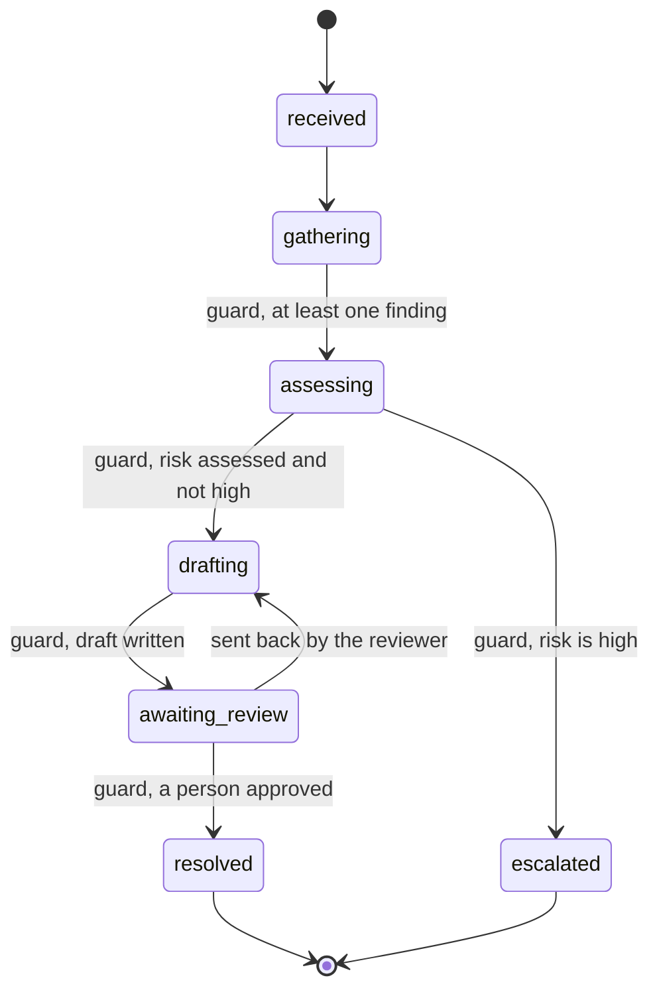
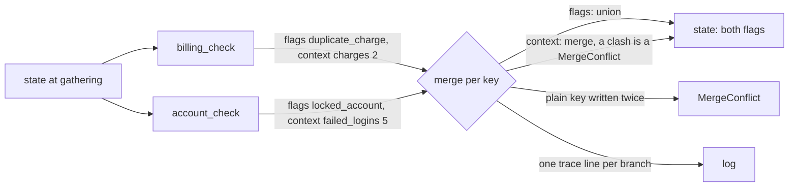

# Lesson 13: State Machines - Architecture

This document shows the ticket workflow's states and guards, how a parallel step merges, the components, and the dropped-finding bug traced through both merge strategies.

## The Workflow



Any move not drawn here raises `InvalidTransition`. Any drawn move whose guard says no raises `GuardFailed` with the guard's reason.

---

## One Parallel Step



---

## Component Layout

```
+-------------------------------------------------------------------+
| TicketState (frozen)                                              |
|   ticket, phase: Phase                                            |
|   flags (union), context (merge), log (append)                    |
|   risk, draft, approved_by (plain: one writer per step)           |
+-------------------------------------------------------------------+
| TRANSITIONS: Phase -> {Phase: Guard}     Guard: state -> reason?  |
| transition(state, to) -> state | InvalidTransition | GuardFailed  |
+-------------------------------------------------------------------+
| REDUCERS: key -> (old, new) -> merged                             |
| merge(state, {branch: partial_update}) -> state | MergeConflict   |
| naive_merge(...)   the overwrite bug, kept for comparison         |
+-------------------------------------------------------------------+
| Branches: billing_check, account_check (rules), assess (model)    |
+-------------------------------------------------------------------+
```

---

## The Dropped-Finding Bug, Step by Step

Ticket: "I was charged twice this month and now I can't log in."

| Step | `naive_merge` (overwrite) | `merge` (per-key rules) |
|---|---|---|
| billing_check returns | `flags=["duplicate_charge"]` | `flags=["duplicate_charge"]` |
| account_check returns (finishes last) | `flags=["locked_account"]` | `flags=["locked_account"]` |
| After merge | `("locked_account",)`: billing finding erased | `("duplicate_charge", "locked_account")` |
| What the model sees | only the lock | both problems |
| Typical diagnosis | "the model ignores billing history" (wrong) | n/a |
| What the log shows | nothing | `billing_check changed ['context', 'flags']`, `account_check changed ['context', 'flags']` |
| If billing finishes last instead | the lock is erased: the bug is flaky | same result either way |
