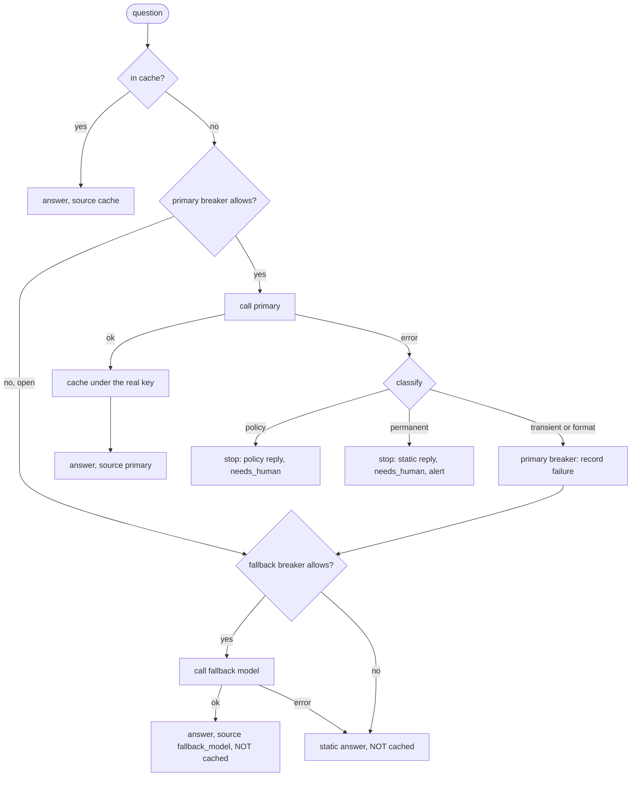
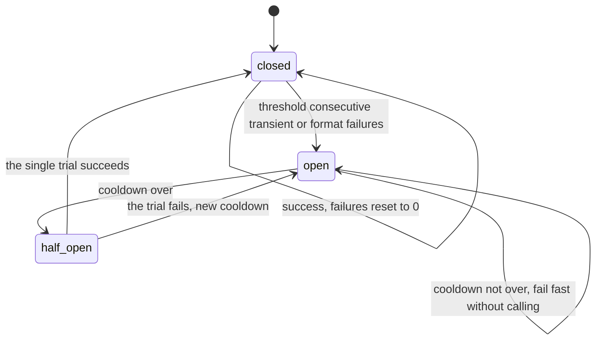

# Lesson 14: Error Handling - Architecture

This document shows how one request moves through the fallback chain, the circuit breaker's states, the components, and an outage traced through a naive and a production service.

## One Request Through the Chain



---

## Circuit Breaker States



Permanent and policy errors are recorded as successes: the provider answered, and the request was the problem.

---

## Component Layout

```
+---------------------------------------------------------------------+
| AnswerService(primary, fallback, clock)                             |
|   answer(question) -> Answer(text, source, error_kind, needs_human) |
|   cache: key -> primary answers only                                |
|   chain: primary + CircuitBreaker, fallback_model + CircuitBreaker  |
|   events: what happened on each attempt                             |
+---------------------------------------------------------------------+
| classify(exception) -> ErrorKind: transient | format |             |
|                                   permanent | policy               |
| CircuitBreaker(threshold, cooldown_s, clock)                        |
|   allow() / record_success() / record_failure(); one half-open trial|
+---------------------------------------------------------------------+
| ProviderError(status), FormatError, PolicyError                     |
+---------------------------------------------------------------------+
```

---

## An Outage, Two Ways

The primary returns 503 for the first three calls, then recovers. One request arrives every 20 seconds.

| t | `@cache` + retry 5x + fallback | This lesson |
|---|---|---|
| 0 s | 5 attempts (~5 s wait), fallback answer **cached forever** | primary fails, fallback answers, not cached |
| 20 s | cache hit: degraded answer | primary fails, fallback answers |
| 40 s | cache hit: degraded answer | primary fails, breaker opens, fallback answers |
| 60 s | cache hit: degraded answer | breaker open: primary skipped, fallback answers at once |
| 80 s | cache hit: degraded answer, still | trial call succeeds, breaker closes, real answer cached |
| Primary calls | 5 (then never again) | 4 |
| After recovery | degraded answer until the process restarts | real answer from the first request after recovery |
