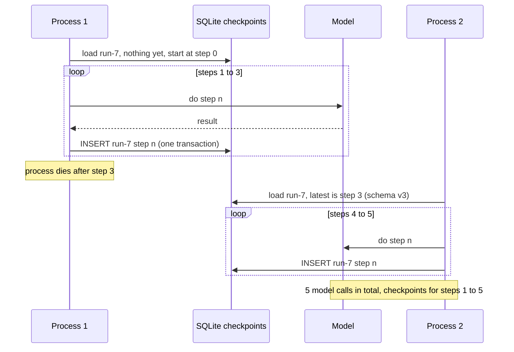
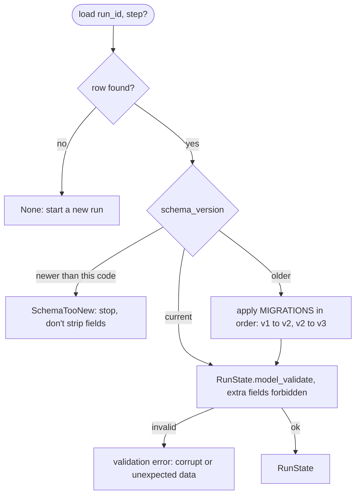

# Lesson 15: Persistence - Architecture

This document shows a crash and resume across two processes, the load path with migrations, the components, and how a naive pickle file and a versioned checkpoint table handle the same events.

## Crash and Resume



---

## The Load Path



---

## Component Layout

```
+---------------------------------------------------------------------+
| checkpoints table (SQLite)                                          |
|   run_id | step | schema_version | state (JSON) | created_at        |
|   PRIMARY KEY (run_id, step)   one row per step, never overwritten  |
+---------------------------------------------------------------------+
| CheckpointStore(path)                                               |
|   save(state)      size check, INSERT in a transaction,             |
|                    duplicate step -> CheckpointConflict             |
|   load(run_id, step?) -> RunState | None   (migrate, then validate) |
|   steps(run_id) -> [1, 2, ...]                                      |
+---------------------------------------------------------------------+
| RunState v3 (Pydantic, extra=forbid): run_id, task, step,           |
|   messages[Message(role, content)], plan, tokens_used               |
| MIGRATIONS: {1: _v1_to_v2, 2: _v2_to_v3}  pure dict -> dict         |
+---------------------------------------------------------------------+
| run_agent(llm, store, run_id, task, total_steps)                    |
|   load latest -> continue from state.step -> save after every step  |
+---------------------------------------------------------------------+
```

---

## Naive vs. Production

| Event | `pickle.dump` to `runs/<id>.pkl` | Versioned checkpoint rows |
|---|---|---|
| Crash during a save | the only copy is half-written | previous rows intact; the transaction never committed |
| Resume after a crash | from the last full overwrite, if it isn't corrupt | from the latest step; completed model calls not repeated |
| "What did the state look like at step 2?" | gone | `load(run_id, step=2)` |
| Field renamed in v3 | `AttributeError` deep in the agent, or a silent default | migration renames it on load, then validation |
| Old code meets a v4 checkpoint | loads what it can and saves it back, damaged | `SchemaTooNew`, nothing written |
| Two writers for one step | last write wins | `CheckpointConflict` |
| 5 MB tool output in the state | every save rewrites 5 MB | refused: store it by reference |
