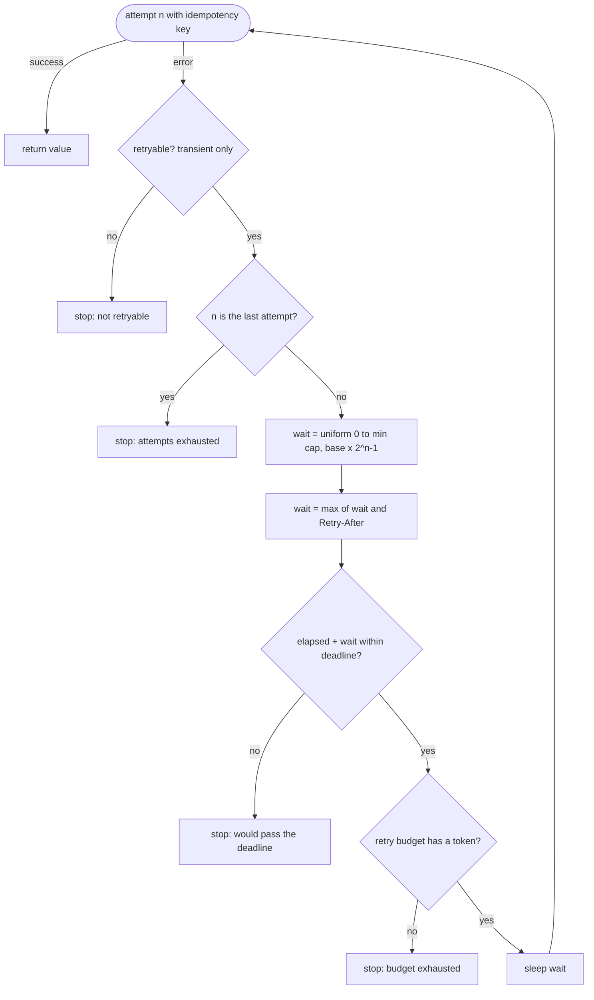

# Lesson 16: Retry Patterns - Architecture

This document shows the decisions made after each failed attempt, how jitter changes the shape of retry traffic, the components, and an outage with and without these rules.

## After Each Failed Attempt



Every exit records its reason, so dashboards can tell "the provider said no" apart from "we chose to stop".

---

## Why Jitter Matters

A thousand clients fail at the same moment and retry on attempt 3, with a 2-second ceiling.

```
No jitter                          Full jitter
time ->  0s        1s        2s    time ->  0s        1s        2s
         .         .         ####          ##########################
                             ####          (spread evenly from 0 to 2 s)
                             ####
1,000 requests in the same ms      ~1 request per 2 ms
```

---

## Component Layout

```
+-------------------------------------------------------------------+
| call_with_retry(fn, idempotency_key, policy, budget,              |
|                 sleep, clock, rng) -> RetryOutcome                |
|   RetryOutcome: ok, value, attempts[Attempt(number, error,        |
|                 waited_s)], stop_reason                           |
+-------------------------------------------------------------------+
| RetryPolicy(max_attempts, base_s, cap_s, deadline_s)              |
|   backoff(attempt, rng) -> full-jitter delay                      |
| RetryBudget(ratio, max_tokens): on_request(), try_spend()         |
| is_retryable(exc): TransientError | TimeoutError | ConnectionError|
| TransientError(message, retry_after?) / PermanentError            |
+-------------------------------------------------------------------+
```

---

## An Outage, With and Without the Rules

The provider is down. 100 user requests arrive, each with a 30-second deadline.

| | `for attempt in range(5): sleep(2 ** attempt)` | This lesson |
|---|---|---|
| Calls to the provider | 500 (5 per request) | 119 (first attempts + budgeted retries) |
| Retry timing | synchronised waves at 1, 3, 7, 15 s | spread by full jitter |
| A 400 among them | retried 5 times | 1 attempt |
| A 429 with `Retry-After: 60` | retried after 1 s, rejected again | gives up at once (past the deadline) |
| Time a user waits before an error | up to 31 s, past their 30 s deadline | bounded by the deadline |
| A refund whose response was lost | applied twice | applied once (same key) |
