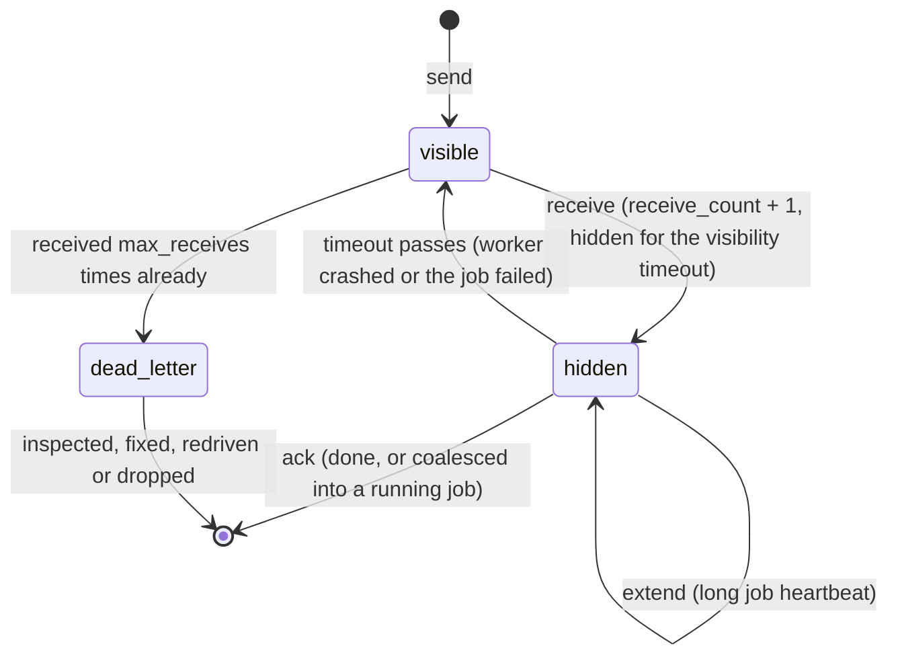
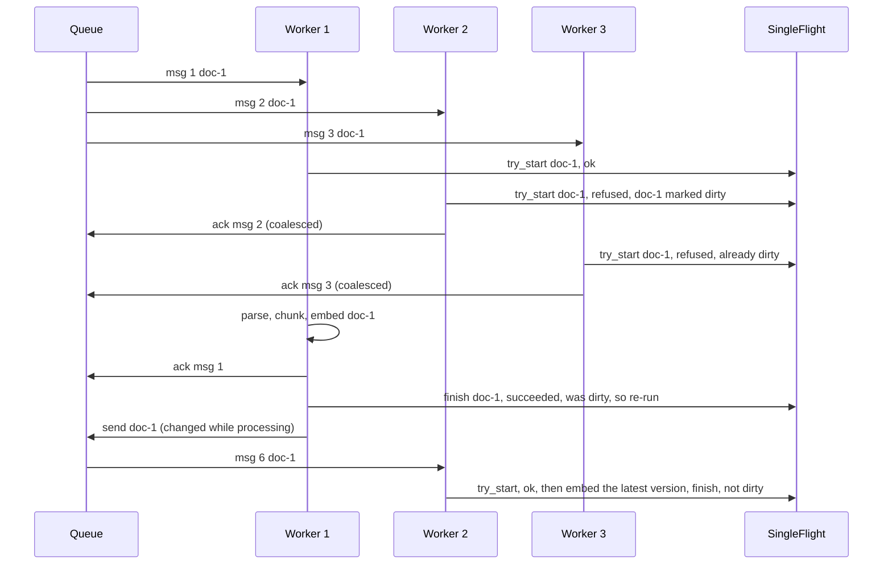

# Lesson 17: Background Workers - Architecture

This document shows a message's life in the queue, the burst of duplicate uploads handled by single-flight, the components, and the same afternoon's uploads handled by a naive and a production worker.

## A Message's Life



---

## Three Uploads of One Document



Two runs in total, never two at the same time, and the last one sees the latest upload.

---

## Component Layout

```
+-------------------------------------------------------------------+
| InMemoryQueue(clock, visibility_timeout_s, max_receives)          |
|   send(body) / receive() / ack(id) / fail(id, error) / extend()   |
|   messages: id -> Message(body, receive_count, visible_at,        |
|                           last_error)                             |
|   dead_letters: [Message]                                         |
+-------------------------------------------------------------------+
| SingleFlight: try_start(entity) -> bool                           |
|               finish(entity, succeeded) -> needs a follow-up run? |
+-------------------------------------------------------------------+
| Worker(queue, flight, process)                                    |
|   handle(message) -> processed | coalesced | failed               |
| run_pool(worker, threads)   N threads: receive -> handle          |
+-------------------------------------------------------------------+
```

---

## Naive vs. Production

| Situation | `jobs.pop(0)` loop | Queue + DLQ + single-flight |
|---|---|---|
| Worker dies mid-job | the job is gone | message reappears after the timeout |
| Corrupt PDF | crashes the loop, or retries forever | 3 attempts, then the dead-letter queue with its error |
| Other documents meanwhile | stuck behind it | processed normally |
| Three uploads of doc-1 at once | three concurrent runs racing to write | one run + one follow-up, never concurrent |
| Which version ends up indexed | whichever run finished last | the latest (the follow-up runs after the burst) |
| Embedding cost for the burst | 3x | 2x at most |
| After a restart | queue lost | queue is external; work resumes |
