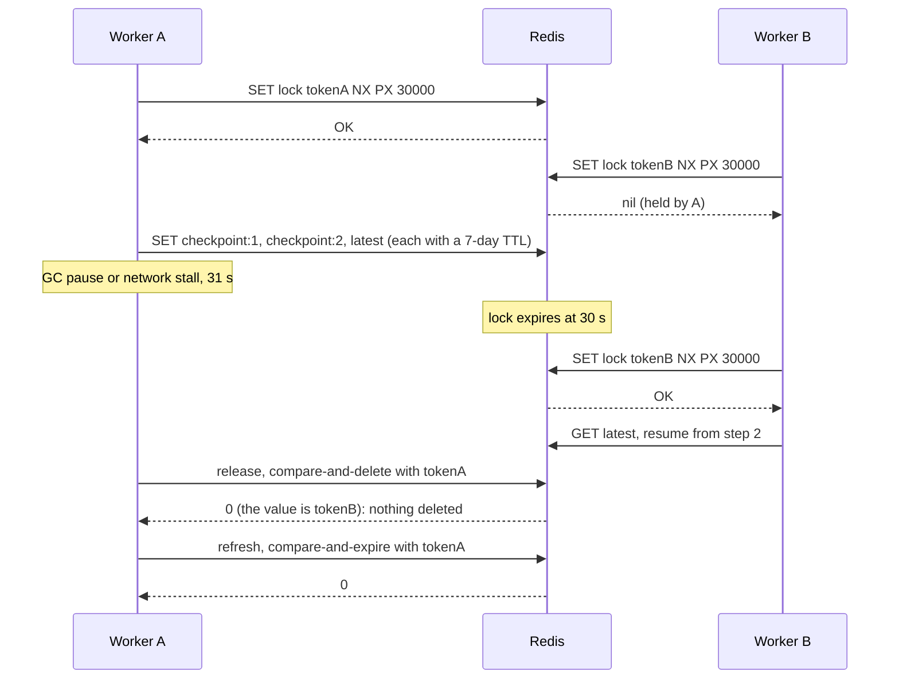

# Lesson 18: Redis Checkpointing - Architecture

This document shows a stalled worker's hand-over, the key layout for one run, the components, and why compare-and-delete matters.

## A Stalled Worker Hands Over



With a plain `DEL`, A's release would have removed B's lock, and a third worker could start the same run.

---

## Key Layout for One Run

```
paie:dev:v1:run:{run-7}:lock                  token (random hex)       PX 30000
paie:dev:v1:run:{run-7}:checkpoint:1          {"step": 1, "state": …}  PX 7 days
paie:dev:v1:run:{run-7}:checkpoint:2          {"step": 2, "state": …}  PX 7 days
paie:dev:v1:run:{run-7}:checkpoint:latest     copy of the newest step  PX 7 days
 │    │   │       └─ hash tag: all keys of run-7 share one cluster slot
 │    │   └─ state-format version
 │    └─ environment
 └─ application
```

---

## Component Layout

```
+-------------------------------------------------------------------+
| KVStore (Protocol): set(key, value, px?, nx?), get, pttl,         |
|                     delete_if_equals, pexpire_if_equals           |
|   FakeRedis(clock)        in-memory, thread-safe, expiring keys   |
|   RedisAdapter(url)       redis-py; compare-and-act via Lua       |
+-------------------------------------------------------------------+
| Keys(env, version): checkpoint(run, step), latest(run), lock(run) |
|   run ids validated: ^[a-z0-9-]{1,64}$                            |
| RunLock(store, keys): acquire(run, ttl) -> token | None,          |
|                       refresh(run, token, ttl),                   |
|                       release(run, token)                         |
| CheckpointStore(store, keys, ttl): save(run, step, state),        |
|                                    load(run, step?)               |
+-------------------------------------------------------------------+
```

---

## Plain DEL vs. Compare-and-Delete

| Moment | Plain `GET`/`SET`/`DEL` lock | `SET NX PX` + token + compare-and-delete |
|---|---|---|
| Two workers start together | both see no lock, both proceed | one `SET NX` succeeds |
| Worker A crashes | lock stays forever | expires after the TTL |
| A stalls past the TTL, B takes over | (no TTL, so B never could) | B holds a new token |
| A wakes and releases | deletes B's lock | no-op: token mismatch |
| A tries to keep working | nothing stops it | refresh fails; A knows it lost the lock |
| A week later | state still in memory | checkpoints expired |
