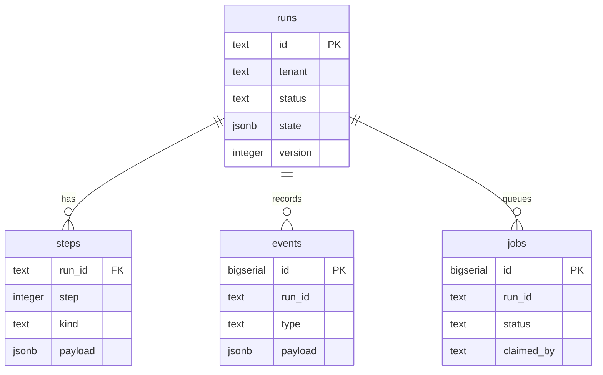
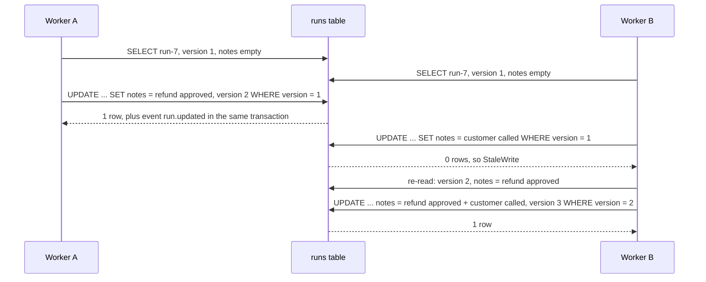

# Lesson 19: PostgreSQL State Store - Architecture

This document shows the schema, a lost update prevented by the version column, concurrent job claiming, the components, and naive vs. production behaviour.

## Schema



`steps` has `PRIMARY KEY (run_id, step)`, so each step is written once. `events` is only ever inserted into.

---

## A Lost Update, Prevented



---

## Concurrent Claiming with SKIP LOCKED

```
jobs:  id 1 queued | id 2 queued | id 3 queued
                                                 Worker A: SELECT ... FOR UPDATE SKIP LOCKED LIMIT 1 -> locks 1
                                                 Worker B: same query -> 1 is locked, skip -> locks 2
                                                 Worker C: same query -> skips 1, 2 -> locks 3
                                                 Worker D: same query -> nothing unlocked -> no row
each UPDATE ... RETURNING marks its row claimed and commits; nobody waited for anybody
```

SQLite has no row locks, so the default store serialises claimers with `BEGIN IMMEDIATE`. The outcome is the same (each job claimed once), with less parallelism.

---

## Component Layout

```
+---------------------------------------------------------------------+
| StateStore (Protocol)                                               |
|   create_run, get_run, update_run(expected_version) -> StaleWrite?  |
|   add_step, events, find_runs(tenant, field, value)                 |
|   enqueue, claim_job(worker)                                        |
+----------------------------------+----------------------------------+
| SqliteStateStore (default)       | PostgresStateStore (optional)    |
|   same tables, JSON as text      |   jsonb + GIN index              |
|   json_extract for lookups       |   state @> lookups               |
|   BEGIN IMMEDIATE for claims     |   FOR UPDATE SKIP LOCKED         |
+----------------------------------+----------------------------------+
update_with_retry(store, run_id, change, attempts)
  read -> change(fresh state) -> update with the version read -> retry on StaleWrite
```

---

## Naive vs. Production

| Situation | Blind `UPDATE`, select-then-update claims | Version column, retry loop, `SKIP LOCKED` |
|---|---|---|
| Two workers add a note to run-7 | one note silently lost | both notes; the loser re-applies its change |
| Ten concurrent writers | an unknown number of notes survive | all ten |
| Four workers, three jobs | two workers can claim job 1 | jobs 1, 2, 3 claimed once each; the fourth gets none |
| Claimers waiting on each other | yes, with a table lock | no: locked rows are skipped |
| What changed, and when | overwritten | `events`: run.created, run.updated (in the same transaction) |
| "Acme's runs for cus-17" | load and parse every row | tenant filter + indexed JSON lookup |
