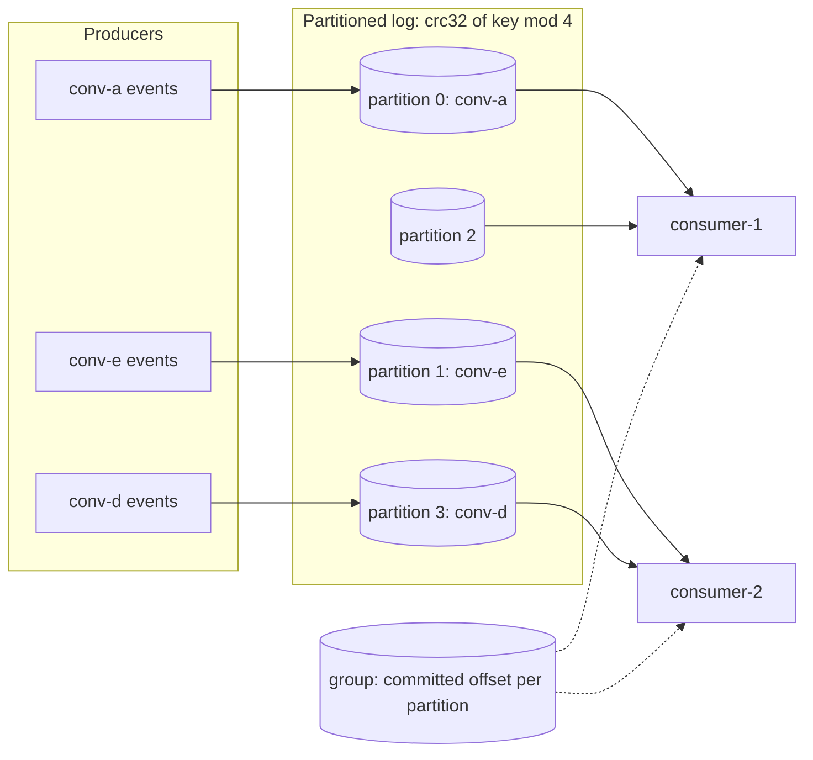
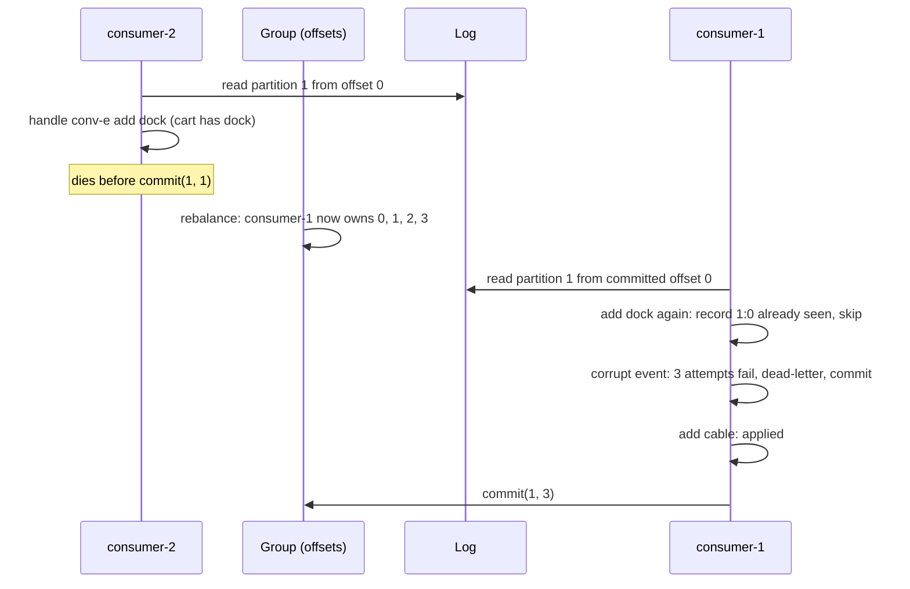

# Lesson 20: Queues - Architecture

This document shows how keys map to partitions and consumers, the crash-and-rebalance sequence, the components, and naive vs. production delivery.

## Keys, Partitions, Consumers



Order holds inside each partition. Partitions are processed in parallel by different consumers.

---

## Crash, Rebalance, Redelivery



---

## Component Layout

```
+-------------------------------------------------------------------+
| PartitionedLog(partitions)                                        |
|   partition_for(key) = crc32(key) % n    append(key, value)       |
|   read(partition, offset, max) -> [Record(partition, offset,      |
|                                          key, value)]             |
+-------------------------------------------------------------------+
| ConsumerGroup(log): rebalance(members) -> partition assignment    |
|                     committed: partition -> next offset           |
+-------------------------------------------------------------------+
| Consumer(name, group, handler, max_attempts)                      |
|   poll(): read from committed -> handle -> commit                 |
|   dead_letters: [DeadLetter(record, error, attempts)]             |
+-------------------------------------------------------------------+
| ConversationAgent: seen record ids (dedup), carts, order_by_key   |
+-------------------------------------------------------------------+
```

---

## Naive vs. Production

| Situation | Any worker, ack first | Partitioned log + group + commit after + dedup |
|---|---|---|
| "add laptop" then "remove laptop" | may run in either order: laptop stays | same partition, in order: laptop removed |
| Two conversations at once | parallel, but unordered within each | parallel across partitions, ordered within |
| Crash during processing | event lost (already acked) | redelivered from the committed offset |
| Crash after processing, before commit | n/a | redelivered and skipped as already seen |
| A consumer leaves | its in-flight events vanish | its partitions move; the new owner resumes at the offset |
| Corrupt event | lost, or retried forever | 3 attempts, dead-lettered, partition continues |
| Replay after a bug fix | impossible | reset offsets; idempotency keeps old effects single |
