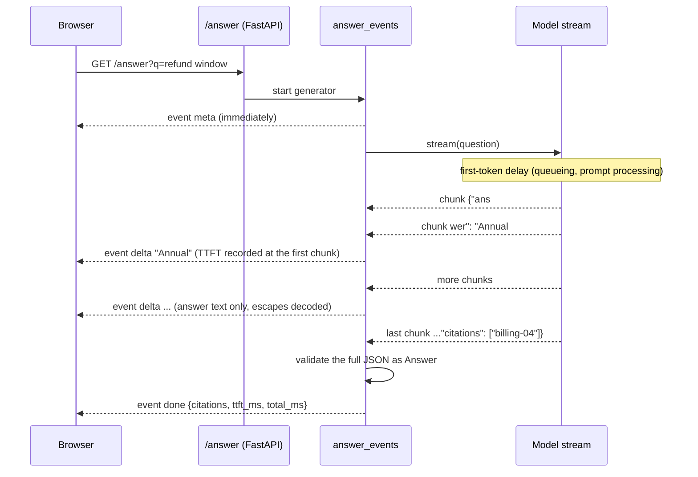
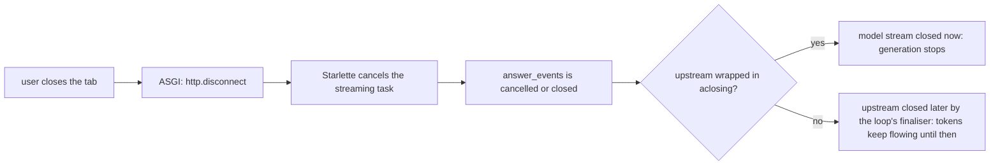

# Lesson 21: Streaming - Architecture

This document shows a streamed answer from model to browser, how a disconnect reaches the model, the components, and naive vs. production streaming.

## One Streamed Answer



If validation fails, the final frame is `error` with `retract: true`, and the browser replaces the text it showed.

---

## How a Disconnect Reaches the Model



---

## Component Layout

```
+----------------------------------------------------------------------+
| create_app(make_llm) -> FastAPI                                      |
|   GET /answer?q=  StreamingResponse(answer_events(...),              |
|                   media_type="text/event-stream",                    |
|                   Cache-Control: no-cache, X-Accel-Buffering: no)    |
+----------------------------------------------------------------------+
| answer_events(llm, question, stats) -> async iterator of SSE frames  |
|   meta -> delta* -> done | error(retract)                            |
|   aclosing(llm.stream(question))                                     |
| AnswerExtractor.feed(chunk) -> new answer text (partial JSON aware)  |
| Answer (Pydantic): answer, citations   validated at the end          |
| StreamStats: ttft_ms, total_ms, chunks                               |
| sse(event, data) / parse_sse(text)                                   |
+----------------------------------------------------------------------+
| StreamingLLM (Protocol): stream(prompt) -> async iterator of str     |
| FakeStreamingLLM: first-token delay, chunk delay, failure,           |
|                   stopped_early                                      |
+----------------------------------------------------------------------+
```

---

## Naive vs. Production

| Situation | Raw tokens in a `StreamingResponse` | Typed SSE frames (this lesson) |
|---|---|---|
| Structured output | the user sees `{"answer": "` and the citation array | only the answer text, decoded as it arrives |
| End of the answer | the stream just stops | `done` with citations, TTFT and total time |
| Final JSON invalid | already on screen, no signal | `error` with `retract: true` |
| Upstream drops mid-answer | looks like a hang | `error` frame |
| Behind a buffering proxy | arrives all at once at the end | headers ask proxies not to buffer |
| User closes the tab | generation continues until finalised | upstream closed immediately (`aclosing`) |
| Latency reporting | one number | TTFT and total, separately |
