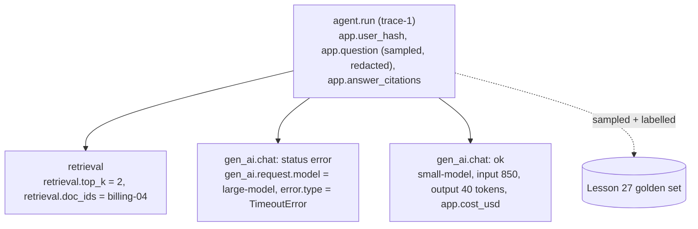
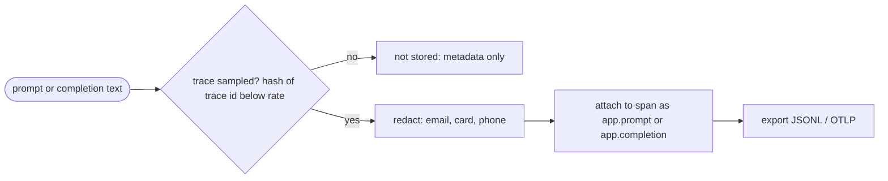

# Lesson 22: Observability - Architecture

This document shows the span tree of one run, the path a piece of prompt text takes before it is stored, the components, and the same failing run seen through logs and through a trace.

## The Span Tree of One Run



---

## What Happens to Prompt Text



Redaction happens inside the process, before export. Nothing unredacted ever reaches the exporter.

---

## Component Layout

```
+-----------------------------------------------------------------------+
| Tracer(clock, content_sample_rate)                                    |
|   span(name, **attributes)  context manager; parent from ContextVar  |
|     error -> status "error" + error.type, then re-raised              |
|   capture_content(span, key, text)   sampled(trace) -> redact(text)   |
|   finished: [Span]  (exporter stand-in)   export_jsonl()              |
+-----------------------------------------------------------------------+
| Span: trace_id, span_id, parent_id, name, start, end, attributes,     |
|       status                                                          |
+-----------------------------------------------------------------------+
| sampled(trace_id, rate)  deterministic per trace                      |
| redact(text)             EMAIL / CARD / PHONE placeholders            |
| cost_usd(model, in, out) tokens x price table (illustrative prices)   |
| trace_summary(spans, trace_id) -> spans, errors, tokens, cost         |
| to_eval_case(spans, trace_id)  -> unlabelled golden-set candidate     |
+-----------------------------------------------------------------------+
```

---

## The Same Failing Run, Logs vs. Trace

The large model times out, the small model answers, and the user's message contains a phone number.

| Question | `logger.info` lines | Trace (this lesson) |
|---|---|---|
| Which run is this? | interleaved with other requests | every span carries `trace_id` |
| Did anything fail? | not logged: only the final reply | `gen_ai.chat` large-model, `status=error`, `TimeoutError` |
| How long did each step take? | no timings | `start`, `end`, `duration_ms` per span |
| What did it cost? | unknown | tokens and `app.cost_usd` per call, summed per trace |
| Which documents were used? | full document text in the log | `retrieval.doc_ids` only |
| The phone number | in plain text, kept for months | `[PHONE]`, and only in sampled traces |
| Can it become a test case? | no | `to_eval_case`, ready for a reviewer's label |
