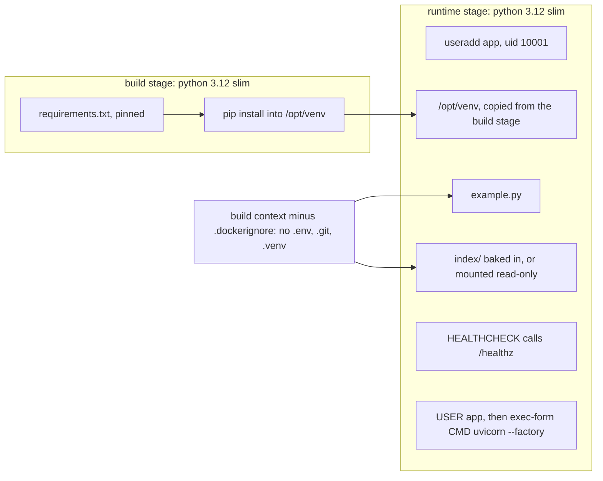
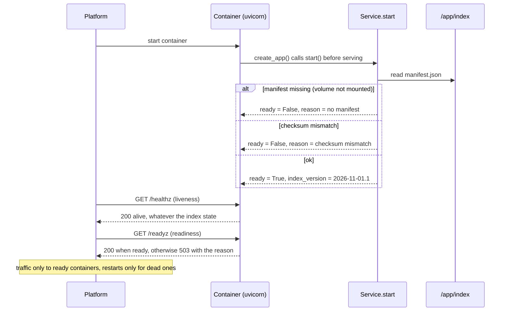

# Lesson 23: Docker - Architecture

This document shows the two build stages, the startup and readiness sequence, the components, and the naive and production images side by side.

## Two Stages, One Small Image



Compilers, pip caches and the build stage's leftovers never reach the runtime image.

---

## Startup and Readiness



---

## Component Layout

```
part-2-production-patterns/23-docker/
  Dockerfile         multi-stage, pinned, non-root, HEALTHCHECK, exec-form CMD
  .dockerignore      .env, .git, .venv, __pycache__, tests
  .gitattributes     index/** -text   (keep the checksummed bytes exact)
  requirements.txt   fastapi, uvicorn, pydantic: pinned
  index/
    index.json       the retrieval documents
    manifest.json    {"version", "file", "sha256"}
  example.py
    load_index(dir) -> (version, documents) | IndexInvalid
    Service: start(), ready, reason, version
    create_app(index_dir?) -> /healthz, /readyz, /search
    lint_dockerfile(text) / lint_dockerignore(text) -> [Finding(rule, message)]
```

---

## Naive vs. Production Image

| Concern | `FROM python:latest`, `COPY .`, one stage | This lesson |
|---|---|---|
| Base image | moves with every upstream push | pinned tag (digest for exact rebuilds) |
| Build cache | every code change reinstalls everything | dependencies in their own layer |
| What ships | compilers, caches, `.git`, `.env` | venv, code, index |
| Secrets | `ENV OPENAI_API_KEY=...` in the image history | injected at run time, never in a layer |
| User | root | uid 10001 |
| Shutdown | `/bin/sh -c` may swallow SIGTERM | exec form: graceful shutdown |
| Missing index volume | "healthy", every query fails | live but not ready: 503 with the reason |
| Tampered index | served | refused by the checksum |
