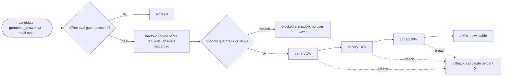
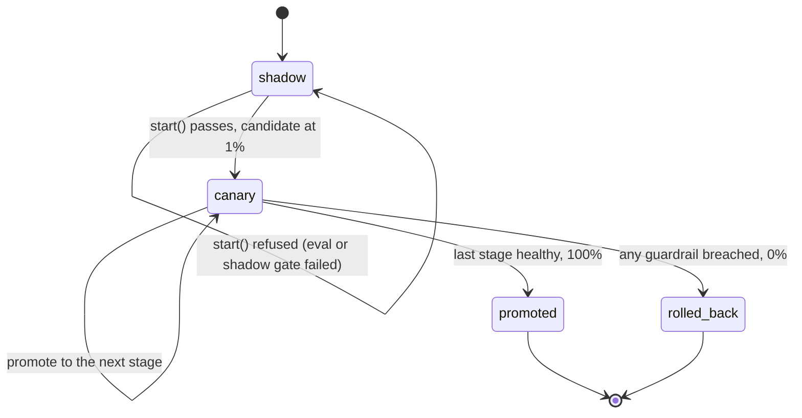

# Lesson 24: Deployment - Architecture

This document shows the release pipeline, the canary controller's states, the components, and the Friday deploy against the staged release.

## The Release Pipeline



At each canary stage the controller holds until both arms have `min_requests`, then promotes or rolls back.

---

## Controller States



---

## Component Layout

```
+---------------------------------------------------------------------+
| Release(name, prompt_version, model)     STABLE, CANDIDATE          |
| Router(stable, candidate, candidate_percent)                        |
|   assign(user_id): bucket(user_id) < percent ? candidate : stable   |
|   bucket = crc32(user_id) % 100   (same on every replica)           |
+---------------------------------------------------------------------+
| serve(router, call, user_id, stats, shadow?, shadow_log?) -> answer |
| ArmStats: requests, errors, schema_failures, latencies, p95         |
+---------------------------------------------------------------------+
| CanaryController(router, stages=(1, 10, 50), min_requests, ...)     |
|   start(offline_eval_passed, stable_stats?, shadow_stats?) -> bool  |
|   evaluate(stable, candidate) -> Decision(promote | hold | rollback)|
|   step(stable, candidate): applies it; log of every move            |
+---------------------------------------------------------------------+
| p95_with_cold_starts(requests, new_instances, base_ms, load_ms,     |
|                      warmed)                                        |
+---------------------------------------------------------------------+
```

---

## The Friday Deploy vs. the Staged Release

The candidate's JSON fails validation about 9% of the time.

| | Edit config, deploy to 100% | Gate → shadow → canary (this lesson) |
|---|---|---|
| Before any user sees it | nothing checked | offline eval, then shadow guardrails |
| First user exposure | everyone, immediately | nobody (blocked in shadow), or 1% if shadow is skipped |
| How the problem is noticed | support tickets on Monday | schema-failure rate vs stable, within one stage |
| Decision rule | someone's judgement | hold below the minimum sample; thresholds vs stable |
| Rollback | git revert + build + redeploy | `candidate_percent = 0`, instant |
| Users mid-conversation | jump between prompts across replicas | sticky by user bucket |
| New instances | cold model load on the first users | warmed before they take traffic |
