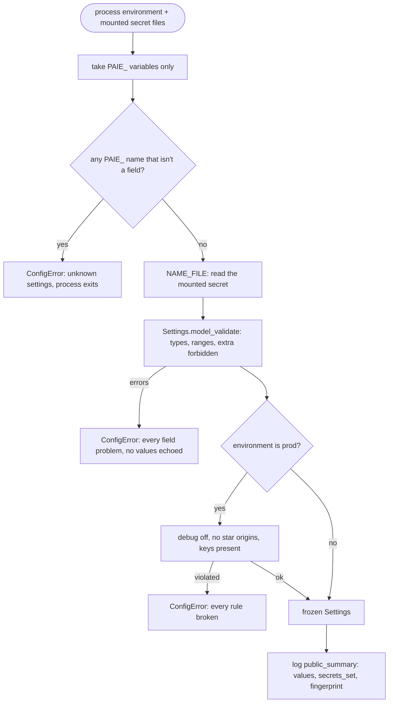
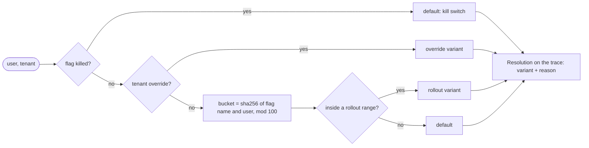

# Lesson 25: Configuration - Architecture

This document shows how settings are built at start-up, how a flag is resolved per request, the components, and a typical misconfiguration handled naively and properly.

## Start-up: From Environment to Settings



---

## Per Request: Resolving a Flag



---

## Component Layout

```
+---------------------------------------------------------------------+
| Settings (Pydantic, frozen, extra=forbid)                           |
|   environment, default_model, request_timeout_s, max_steps,         |
|   daily_budget_usd, allowed_origins, debug                          |
|   llm_api_key: SecretStr?, database_url: SecretStr?                 |
|   _production_rules (model validator)   public_summary()            |
| load_settings(env) -> Settings | ConfigError                        |
|   PAIE_<NAME>, PAIE_<NAME>_FILE, unknown names rejected             |
+---------------------------------------------------------------------+
| Flag(name, variants, default, rollout, tenant_overrides, killed)    |
| FlagStore: set(flag, actor) -> validated + audited                  |
|            resolve(name, user_id, tenant) -> Resolution             |
+---------------------------------------------------------------------+
```

---

## A Misconfigured Deploy, Two Ways

The production deploy has `DEBUG=true`, `MAX_STEP=12` (a typo) and no API key.

| | `os.getenv` scattered through the code | `load_settings` + flags (this lesson) |
|---|---|---|
| Typo `MAX_STEP` | ignored; runs with 8 steps | `ConfigError: unknown settings` at start-up |
| `DEBUG=true` in production | runs, with debug pages exposed | refused: "debug must be off in production" |
| Missing API key | found by the first user request | refused at start-up, alongside the other problems |
| What's logged | possibly the whole environment, key included | the public summary: no secret values |
| The new prompt misbehaves | edit a constant and redeploy | kill switch: everyone back on v2 in seconds |
| "Who changed the model?" | `git blame`, if it was a commit | the flag audit: actor, flag, change |
