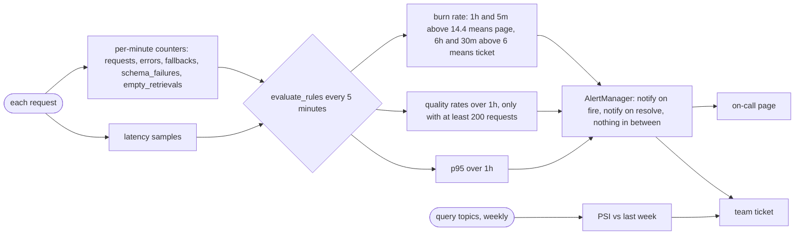

# Lesson 26: Monitoring - Architecture

This document shows how signals flow from requests to notifications, how the two-window burn-rate rule behaves during an incident, the components, and the naive and production setups side by side.

## From Requests to Notifications



---

## The Two-Window Rule During an Outage

```
errors:   0% ......... 30% from h30 to h32 ............ 0% ......
burn 1h:  0 .......... rises past 14.4 at about h30.48, falls slowly after h32 (still above at h32.2)
burn 5m:  0 .......... above 14.4 within 5 minutes; back to 0 five minutes after recovery
page:     .........................FIRING h30.48 ..... resolved h32.07 ...
          (needs both)               (long window confirms)   (short window clears it)
```

Without the short window the page would stay on until the one-hour window forgot enough of the outage: with 30% errors, about 31 minutes after users stopped seeing them (30 × (60 − t) / 60 stays above 14.4 until t ≈ 31).

---

## Component Layout

```
+-------------------------------------------------------------------+
| Metrics(clock)                                                    |
|   inc(name, value, **labels)   labels restricted to ALLOWED_LABELS|
|   observe_latency(ms)                                             |
|   total(name, window_s), p95(window_s)                            |
+-------------------------------------------------------------------+
| SLO(objective).burn_rate(bad, total)                              |
| evaluate_rules(metrics, slo, min_requests) -> [Alert]             |
|   burn-rate page and ticket, quality rates, p95                   |
| AlertManager.update(alerts, at): FIRING once, resolved once       |
| psi(reference, current) -> drift score                            |
+-------------------------------------------------------------------+
```

---

## Naive vs. Production

| Situation | Page on every 5xx, `user_id` labels | SLO burn rates + quality signals (this lesson) |
|---|---|---|
| Metric storage | a time series per user | a handful of series |
| 5-minute total blip | ~100 pages | no page (the long window isn't burning) |
| 2-hour outage at 30% errors | hundreds of pages | one page at about 29 min, one resolve after recovery |
| Prompt change breaks 2.5% of JSON | nothing (status 200) | one schema-failure ticket |
| 1 failure in 3 requests at 4 a.m. | page | below the volume floor: nothing |
| New topic users ask about | discovered from complaints | PSI jump, then empty-retrieval alert |
| "Is it over?" | unclear | resolve notification within minutes |
