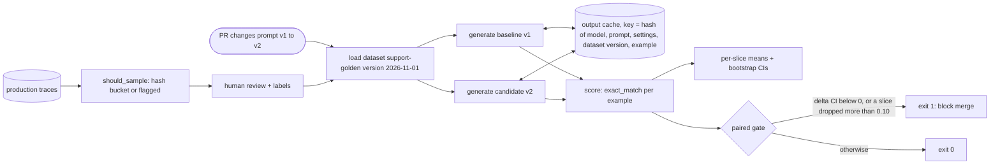
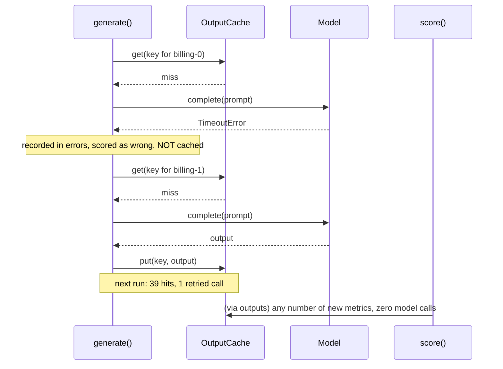

# Lesson 27: Evaluation Pipelines - Architecture

This document shows the pipeline from a pull request to a gate decision, how the cache and scoring are separated, the components, and the demo's candidate judged by a naive and a production gate.

## From Pull Request to Gate



---

## Generation vs. Scoring



---

## Component Layout

```
+---------------------------------------------------------------------+
| Dataset(name, version, examples[Example(id, question, expected,     |
|                                          slice)])                   |
| RunConfig(model, prompt_version, prompt_template, temperature, seed)|
|   cache_key(dataset, example)                                       |
+---------------------------------------------------------------------+
| generate(model, config, dataset, cache) -> outputs, RunStats        |
|   RunStats: model_calls, cache_hits, errors                         |
| OutputCache(path?)  JSONL, successful outputs only                  |
+---------------------------------------------------------------------+
| score(outputs, dataset, scorer) -> {example_id: score}              |
| bootstrap_ci(values) -> (low, high)                                 |
| gate(baseline, candidate, dataset, max_slice_drop, min_slice_n)     |
|   -> GateResult(passed, overall_delta, delta_ci, reasons, notes)    |
| should_sample(trace_id, rate, flagged) -> bool                      |
+---------------------------------------------------------------------+
```

---

## The Demo's Candidate, Two Gates

| | `evaluate(new) >= evaluate(old)` | Paired gate (this lesson) |
|---|---|---|
| Overall | 0.875 ≥ 0.850, so ship | delta +0.025, CI (-0.1, 0.15): no significant change either way |
| Shipping slice | not looked at | 0.92 → 0.67 with n=12: **fail** |
| Cost of the comparison | 80 generations every time | 40 for the new prompt; baseline from the cache |
| A timeout during the run | crash, or a cached empty answer | one error recorded and retried next run |
| Reproducible later? | no record of settings | dataset version + config in every key |
| Decision | ships a broken shipping experience | blocked, with the reason printed |
