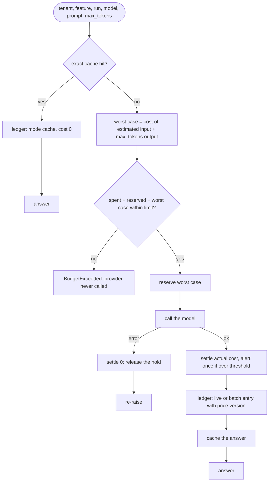
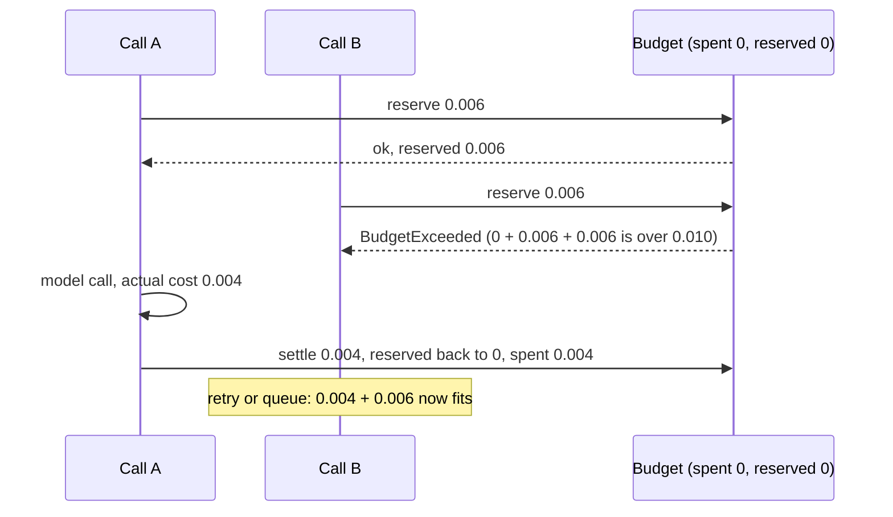

# Lesson 28: Cost Tracking - Architecture

This document shows the path of one priced call, how reservations behave under concurrency, the components, and the same busy afternoon under naive and production accounting.

## One Priced Call



---

## Why Reservations Matter Under Concurrency

Limit $0.010. Two calls start at the same moment, each with a worst case of $0.006.



Without reservations, both calls would read "spent 0", both would pass, and the worst case would come to $0.012.

---

## Component Layout

```
+----------------------------------------------------------------------+
| CostAwareClient(models, ledger, budget, cache)                       |
|   complete(tenant, feature, run_id, model, prompt, max_tokens, batch)|
|   cascade(tenant, feature, run_id, prompt, accept) -> answer, model  |
+----------------------------------------------------------------------+
| Budget(limits, alert_at, on_alert)                                   |
|   reserve(tenant, worst_case) -> Reservation | BudgetExceeded        |
|   settle(reservation, actual)   spent += actual, alert once          |
+----------------------------------------------------------------------+
| Ledger: append-only [LedgerEntry(run_id, tenant, feature, model,     |
|         input_tokens, output_tokens, cost_usd, mode, price_version)] |
|   total(**filters), by(field)                                        |
+----------------------------------------------------------------------+
| PRICES (versioned, illustrative), call_cost(model, in, out, batch)   |
+----------------------------------------------------------------------+
```

---

## A Busy Afternoon, Two Ways

A bulk report job and the support chat share tenant acme's daily limit.

| | Global counter, checked after each call | Ledger + reservations (this lesson) |
|---|---|---|
| Which feature spent the money? | unknown | `ledger.by("feature")`: report vs support_chat |
| The call that crosses the limit | made, then an alert | refused before the provider is called |
| Five calls in flight at the limit | all five complete | each must fit `spent + reserved + worst case` |
| Alerts | one per call after the limit | one per tenant at the threshold |
| The same question asked twice | paid twice | second is a zero-cost cache entry |
| Easy questions | top-model price | small model, escalating only when the check fails |
| Last month's report after a price change | silently recomputed | entries keep their `price_version` |
