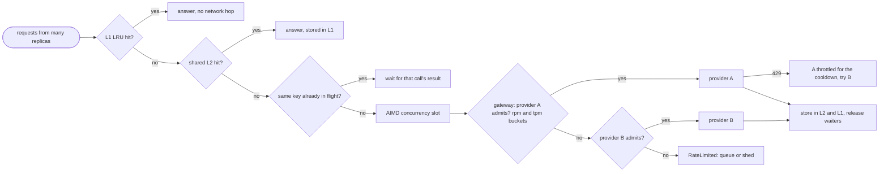

# Lesson 30: Scaling - Architecture

This document shows where each scaling mechanism sits on the path of a request, the AIMD sawtooth, the components, and naive vs. production behaviour under a burst.

## The Path of a Request



Embedding calls take a side path through the `MicroBatcher`: many single requests, one provider call per batch.

---

## AIMD Finding the Capacity

```
limit
 20 |                 /|          /|          /|        provider's real capacity
    |               /  |        /  |        /  |
    |            /     |     /     |     /     |
 10 |        /         | /         | /         |
    |    /             v           v           v   halve on a 429
  4 | /
    +--------------------------------------------------> time
       +1 per window of successes (additive increase)
```

---

## Component Layout

```
+---------------------------------------------------------------------+
| TokenBucket(per_minute, clock).try_take(amount)                     |
| Provider(name, rpm bucket, tpm bucket, call, throttled_until)       |
|   admit(tokens, now): both buckets or neither                       |
| Gateway(providers, clock, cooldown).complete(prompt, tokens)        |
|   -> (provider name, answer) | RateLimited                          |
+---------------------------------------------------------------------+
| AIMDLimit(limit, minimum, maximum): on_success() / on_throttle()    |
| MicroBatcher(embed_batch, max_batch, max_wait_s).embed(text)        |
| TieredCache(l2, l1_size).get_or_compute(key, compute)               |
|   L1 OrderedDict LRU -> L2 shared dict -> single-flight compute     |
+---------------------------------------------------------------------+
```

---

## A Burst, Naive vs. Production

1,200 requests in ten seconds. Provider A allows 600 per minute, provider B 300 per minute, and many requests are duplicates.

| | More replicas + retry on 429 | Buckets + gateway + AIMD + batching + cache |
|---|---|---|
| Provider A | flooded, 429s, retries add load | about 700 served, nothing sent beyond its limits |
| Provider B | unused | takes the overflow (about 320) |
| Beyond both limits | timeouts and retry storms | 179 explicit `RateLimited`, queued or shed by the caller |
| Duplicate questions | computed once per request | one call per key; everyone else waits or hits a cache |
| Embedding 100 chunks | 100 calls | 4 calls |
| Concurrency setting | hand-tuned, wrong half the day | AIMD sawtooth just under the real capacity |
