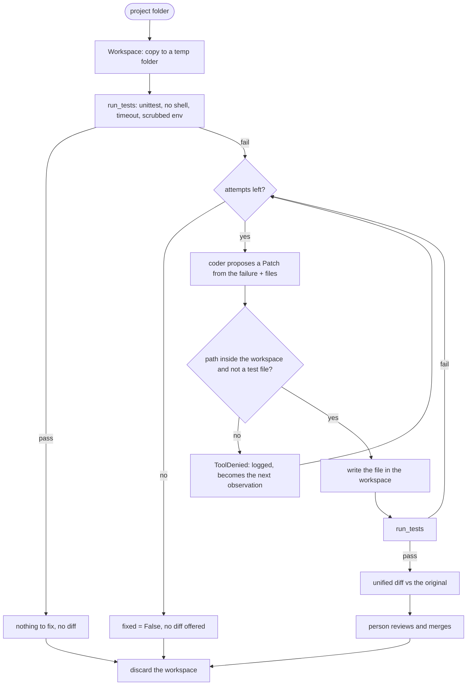

# System: Coding Agent - Architecture

This document shows the repair loop, the sandbox boundaries, the components, and the demo's three attempts.

## The Repair Loop



---

## Sandbox Boundaries

```
+---------------------------- host ------------------------------------+
|  original project  (read once, never written)                        |
|  environment: PATH, API keys, tokens, ...                            |
|                                                                      |
|   +------------------- workspace (temp copy) -------------------+   |
|   |  pricing.py         agent may read and write                |   |
|   |  test_pricing.py    agent may read, may NOT write           |   |
|   |  ../anything        refused (resolved path must stay here)  |   |
|   |                                                             |   |
|   |  run_tests():  python -m unittest -q                        |   |
|   |    env = PATH, SYSTEMROOT, TEMP, TMP only  (no keys)        |   |
|   |    timeout 30 s, last 2,000 chars of output                 |   |
|   +-------------------------------------------------------------+   |
+----------------------------------------------------------------------+
```

---

## Component Layout

```
+---------------------------------------------------------------------+
| repair(project, coder, max_attempts) -> Outcome(fixed, attempts,    |
|                                                 diff, log)          |
+---------------------------------------------------------------------+
| Workspace(source): read(path), write(path, content), run_tests(),   |
|                    diff(), discard()      ToolDenied on violations  |
| sandbox_env() -> minimal environment                                |
| Patch(path, content, note)   CoderLLM (Protocol)   ScriptedCoder    |
+---------------------------------------------------------------------+
```

---

## The Demo's Attempts

| Attempt | Proposal | Guard | Tests | Note |
|---|---|---|---|---|
| baseline | — | — | fail (`apply_discount(2000, 10)` returns 2000 − 2000 × 10 // 10 = 0, expected 1800) | — |
| 1 | change the test to expect the buggy value, 0 | **denied**: tests are read-only | not run | the refusal goes back to the model |
| 2 | `// 1000` | allowed | fail | wrong scale |
| 3 | `// 100` | allowed | **pass** | diff offered for review |
