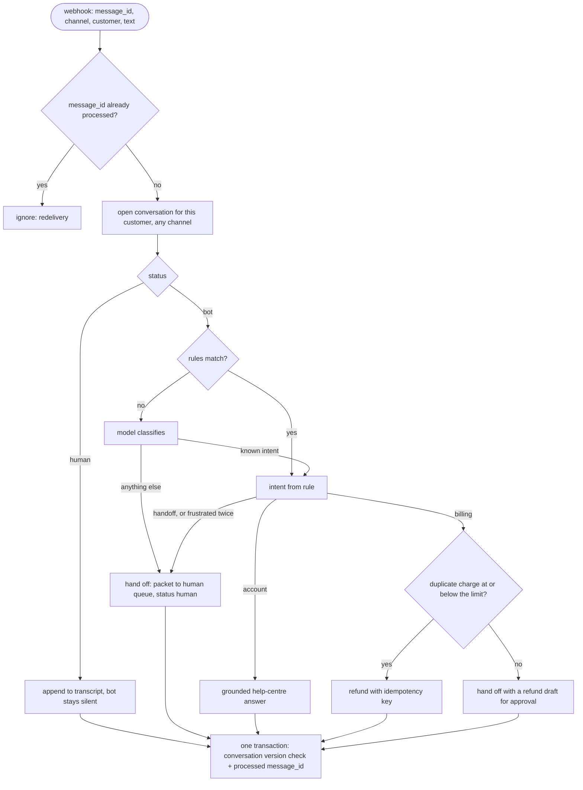
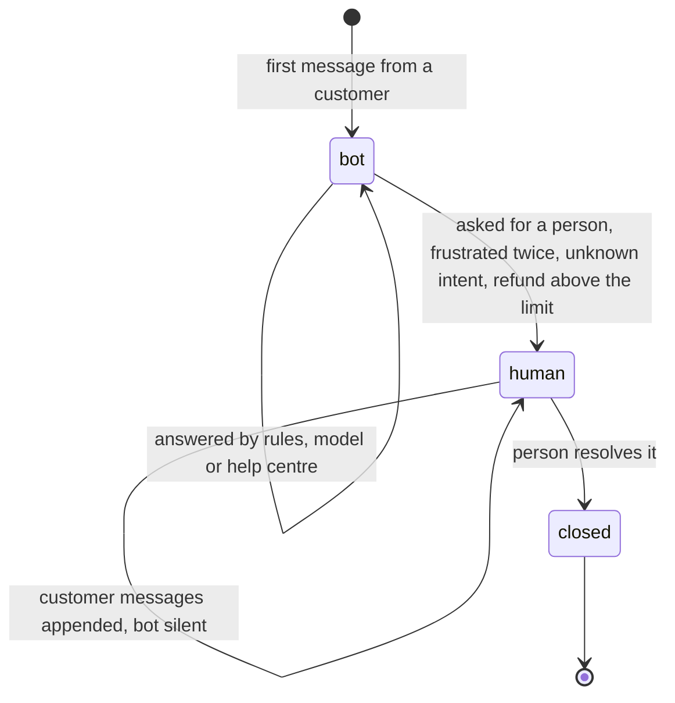

# System: Customer Support - Architecture

This document shows how one inbound message is handled, the conversation's states, the components, and the demo's messages traced through the system.

## One Inbound Message



---

## Conversation States



---

## Component Layout

```
+---------------------------------------------------------------------+
| SupportAgent(store, llm, auto_refund_limit_cents)                   |
|   handle(InboundMessage) -> reply | None                            |
|   route(text) -> (intent, source)   RULES first, then the model     |
|   _bot_reply / _hand_off   refunds (idempotent), human_queue        |
+---------------------------------------------------------------------+
| ConversationStore (SQLite)                                          |
|   conversations(id, customer_id, status, body JSON, version)        |
|   processed(message_id PK)                                          |
|   seen(id), open_for(customer), commit(conv, message_id)            |
+---------------------------------------------------------------------+
| InboundMessage(message_id, channel, customer_id, text)              |
| Conversation(id, customer_id, status, transcript, handoff, version) |
| LLMClient (Protocol)   KeyedLLM                                     |
+---------------------------------------------------------------------+
```

---

## The Demo's Messages

| Message | Path | Result |
|---|---|---|
| wa-1 acct-3 "charged twice, please refund" | rule → billing → 20.00 ≤ limit | refunded, key `refund:conv-acct-3:ord-2` |
| wa-1 again (redelivered) | already processed | `None`, no second refund |
| ch-1 acct-17 "charged twice" | rule → billing → 180.00 > limit | hand-off with refund draft |
| em-1 acct-17 "any update?" (email) | same conversation, status human | `None`, appended for the person |
| ch-2 acct-40 "locked out" | rule → account | help-centre answer |
| ch-3 acct-41 "my thing broke" | model → account | help-centre answer |
| ch-4 acct-42 "weird question" | model → "SHIPPING-ISH" (unknown) | hand-off |
