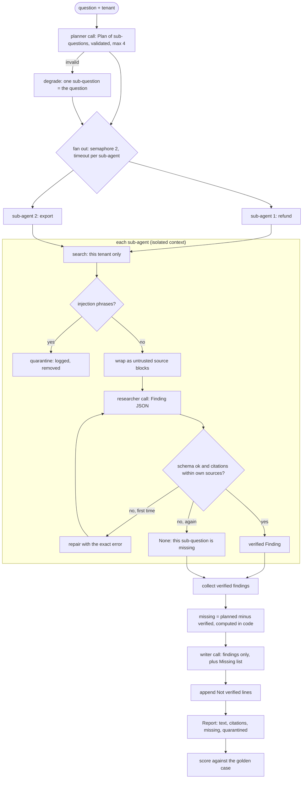

# System: Research Assistant - Architecture

This document shows the full run, where each safeguard sits, the components, and how the demo's two runs differ.

## One Run, End to End



Every model call passes through `Harness.charge` (budget) and `Harness.span` (trace).

---

## Where Each Safeguard Sits

| Threat | Safeguard | Location |
|---|---|---|
| Globex documents in an Acme answer | tenant filter before ranking | `search` |
| "Ignore previous instructions…" in a wiki page | quarantine + untrusted markers | `research` |
| A cited source that wasn't provided | citation check, repair once, fail closed | `research` |
| A sub-agent that hangs | `asyncio.wait_for` per sub-agent | `run.bounded` |
| A sub-question with no verified answer | `missing` computed in code, appended to the report | `run` |
| Runaway calls | `max_calls` budget | `Harness.charge` |
| "Why did it say that?" | span per step | `Harness.trace` |
| Regressions | golden facts and citations | `score` |

---

## Component Layout

```
+------------------------------------------------------------------------+
| ResearchAssistant(llm, harness, max_parallel, timeout_s)               |
|   run(question, tenant) -> Report(text, citations, missing,            |
|                                   quarantined)                         |
|   plan() -> Plan  research() -> Finding | None  _call() budget + trace |
+------------------------------------------------------------------------+
| search(query, tenant, k)   BM25 over CORPUS, tenant-filtered first     |
| Plan / Finding (Pydantic, extra=forbid)                                |
| Harness(max_calls, price): charge(role), span(name, ...), cost_usd     |
| score(report, required_facts, expected_citations)                      |
| LLMClient (Protocol)   RuleBasedLLM(fabricate_once, slow_on)           |
+------------------------------------------------------------------------+
```

---

## The Demo's Two Runs

| | Run 1: fabricated citation once | Run 2: slow export sub-agent |
|---|---|---|
| Plan | refund + export sub-questions | same |
| Quarantined | `wiki-export` | `wiki-export` |
| Refund finding | rejected (`pol-made-up`), repaired → `pol-refund` | `pol-refund` |
| Export finding | `pol-export` | timed out → missing |
| Report | both answers with citations | refund answer + "Not verified: …export…" |
| `complete` | True | False |
| Eval | passed (facts 1.0, citations ok) | failed (facts 0.5) |
